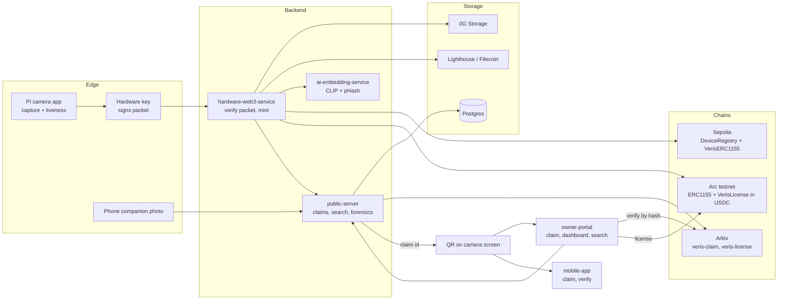
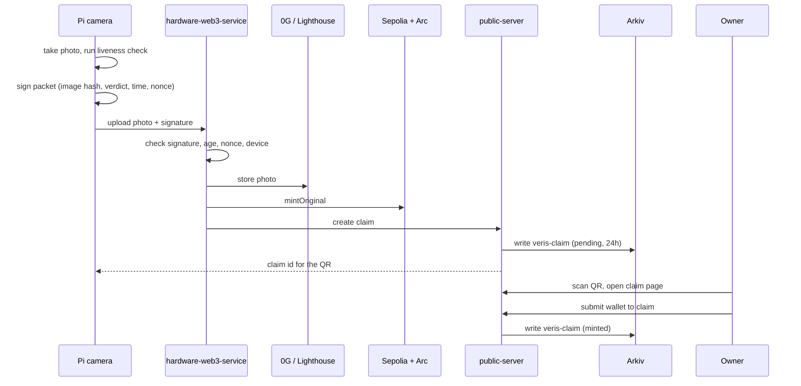
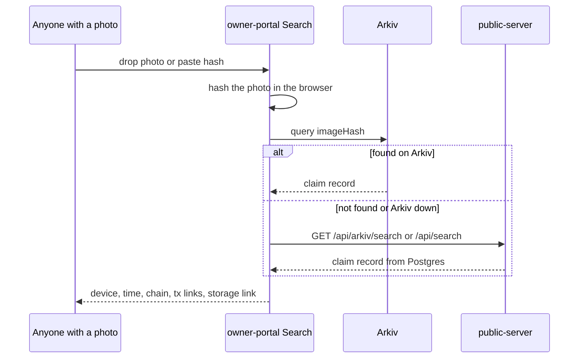

# Veris

**A camera that signs every photo at the moment it is taken, so anyone can check it is real.**

> 📸 TODO: hero photo of the finished camera (see `assets/COMPONENTS` for build shots).

> 📸 TODO: demo video link.

## Prize tracks

| Sponsor / track | What we built | Verify it |
|---|---|---|
| [Arkiv](#arkiv-ethglobal-mumbai-continuity-track) (Continuity) | Provenance and license records, queryable by anyone | `curl` the verify endpoint below |
| [Arc Studio](#arc-arc-studio-continuity-track) (Continuity) | Mint on Arc testnet and USDC photo licensing | Arc contracts in the Deployed table |
| [Ethereum Foundation, CROPS](#crops) (Continuity) | Photo verification that works without our server | Drop a photo on Search with `api.veris.live` blocked |

- Not in the code on `main`: vlayer, RISC Zero, Synapse SDK calls. They are not claimed here. The Solana program is on the `solana-migration` branch, not on `main`.
- Every sponsor feature sits behind an env flag and falls back to the older path. A capture never fails because a sponsor is down.

### Arkiv (ETHGlobal Mumbai, Continuity track)

- **Prize:** Build on Arkiv (existing projects).
- **Existed before the event:** camera, hardware signing, Filecoin/Lighthouse storage, Postgres claim server, ERC-1155 contracts, owner portal, mobile app.
- **Added at the event:** `public-server/arkivService.js` mirrors each claim to Arkiv; pending ones expire in 24 hours, minted ones get the longest life Arkiv allows.
- **Added at the event:** a `veris-license` entity per USDC license on Arc, expiring exactly when the term ends.
- **Added at the event:** `GET /api/arkiv/search`, and a browser-side lookup in `owner-portal/src/lib/arkivDirect.js` that asks Arkiv first.
- **Flag and fallback:** `ARKIV_ENABLED`; reads fall back to Postgres, failed writes are retried.
- **Writer wallet (Arkiv testnet, chain id 7794095):** `0xC15aF2A372D01B5223819bB328400DB8b14d1894`
- **Live result (2026-11-06):** 14 `minted` and 0 `pending` claim entities.
- **Verify:** `curl "https://api.veris.live/api/arkiv/search?imageHash=940d4b013da66f9d767e04e0fe516222c6193b3c4b476bdf022e8fd24e7986f3"` returns `"source":"arkiv"` with two minted claims (Arc tokens 12 and 13).
- **Details:** [arkiv/README.md](arkiv/README.md), [schema](arkiv/schema.md), [how we use Arkiv](arkiv/how-you-use-arkiv.md), [why Arkiv](arkiv/why-arkiv.md), [reach](arkiv/reach.md), [friction](arkiv/friction.md).
- **Service README:** `public-server/README.md`.

A query you can run (get a key at https://hub.arkiv.network/access-keys):

```js
import { createPublicClient } from '@arkiv-network/sdk'
import { rabdi } from '@arkiv-network/sdk/chains'
import { eq } from '@arkiv-network/sdk/query'
import { http } from 'viem'
// Claims is the `veris-claim` schema from arkiv/schema.md
const client = createPublicClient({ chain: rabdi({ accessKey: process.env.ARKIV_ACCESS_KEY }), transport: http() })
const r = await client.select({ $key: true, status: true }).from(Claims).where(eq('status', 'minted')).limit(5).fetch()
```

- Underneath it is the filter `arkiv.schema = str('veris-claim') AND status = str('minted')`.
- Example entity: `0x309b48e503a9447378b6f2285296f9c44b8ea3a4bd72957645e083b8a7f3b958`.
- **How AI was used:** Claude Code helped write the Arkiv service, the license contract and the docs under `arkiv/`; the team reviewed and tested every change.

### Arc (Arc Studio, Continuity track)

- **Prize:** Arc Studio Continuity Track, Bring Your Project to Arc. Bounty: USDC payment flows added to an existing commerce product.
- **Existed before the event:** single-chain mint on Sepolia, `DeviceRegistry`, `VerisERC1155`, the claim page and dashboard.
- **Added at the event:** the same ERC-1155 mint on Arc testnet, next to Sepolia (`CHAINS=sepolia,arc`).
- **Added at the event:** `VerisLicense`: an editor pays 5 USDC to license a photo for 30 days, paid straight to the photographer.
- **Files:** `contracts/src/VerisLicense.sol`, `hardware-web3-service/chains.js`, `owner-portal/src/lib/arc.js`, `owner-portal/src/components/LicenseButton.jsx`, `public-server/server.js` (`/api/license/record`).
- **Flag and fallback:** `CHAINS` lists the extra chains; an Arc failure is queued for retry and never fails the Sepolia mint.
- **Verify:** open the Arc contracts from the Deployed table on `https://testnet.arcscan.app`.
- **Details, diagram and tx hashes:** [prizes/arc.md](prizes/arc.md).
- > TODO: Arc Studio project URL.

### Ethereum Foundation: Best CROPS Upgrade (Continuity track)

- **New property:** verifying a photo does not need our server. See [CROPS](#crops) below and [prizes/crops.md](prizes/crops.md).

## The problem

- AI images look like photos now.
- Nobody can tell a real photo from a fake one.
- Photographers have no simple proof that they took a shot.

## The solution

- A Raspberry Pi camera signs each photo with a hardware-bound key.
- The photo is stored on decentralized storage and minted as an NFT.
- A QR code lets the owner claim it; a public page lets anyone verify it.

## Why it matters

- Real photos get proof, not just trust.
- Fakes cannot reuse a capture: every packet has a nonce and a timestamp.
- Checking a photo needs no account and no access to our server.
- Photographers can license photos and get paid in USDC.
- Provenance is public on Arkiv, so it outlives our hosting.

## End to end



## Capture to claim



## Verify



## Services

| Service | What it does | README |
|---|---|---|
| `hardware-camera-app` | Pi app: capture, liveness, hardware signing, QR | [hardware-camera-app/README.md](hardware-camera-app/README.md) |
| `hardware-web3-service` | Verifies the packet, stores the photo, mints on each chain | `hardware-web3-service/README.md` |
| `public-server` | Claims, QR pages, search, forensics, Arkiv mirror | `public-server/README.md` |
| `owner-portal` | React site: claim, dashboard, search, license | `owner-portal/README.md` |
| `mobile-app` | Expo app: claim and verify on a phone | [mobile-app/README.md](mobile-app/README.md) |
| `contracts` | Solidity: DeviceRegistry, VerisERC1155, VerisLicense | `contracts/README.md` |
| `ai-embedding-service` | FastAPI: CLIP embedding and pHash for similar-photo search | `ai-embedding-service/README.md` |
| `ai-model` | Research code for image comparison, not wired into the pipeline | `ai-model/README.md` |
| `arkiv` | Design notes for the Arkiv part | [arkiv/README.md](arkiv/README.md) |

- Per-service READMEs are written alongside this one; paths above are relative to the repo root.

## Trust model

**What is signed**
- The camera signs a packet: image hash, companion hash, liveness verdict, timestamp, nonce, device address.
- The key is secp256k1, derived from device identifiers plus a salt on the Pi.
- The format lives in `hardware-web3-service/packet.js` and `hardware-camera-app/capture_pipeline.py`.

**What is checked**
- The backend rejects packets that are too old, from the future, or a replayed nonce.
- Minting needs the device to be active in `DeviceRegistry`.
- A liveness check tags the shot as live or not; if no engine answers, it stays `pending`.
- Companion capture compares a phone photo to the camera photo of the same scene.
- There is no ZK proof in the current code.

**What is stored where**

| Data | Where |
|---|---|
| The photo | 0G Storage or Lighthouse (IPFS/Filecoin) |
| Ownership and device identity | ERC-1155 and DeviceRegistry on Sepolia and Arc |
| Licenses | `VerisLicense` on Arc, paid in USDC |
| Permanent claim record | Postgres on `public-server` |
| Public, queryable copy | Arkiv (see [arkiv/schema.md](arkiv/schema.md)) |
| Device private key | Only on the Pi |

## Tech stack

| Layer | Tech |
|---|---|
| Camera | Python, Kivy, Picamera2, OpenCV |
| Backend | Node.js (ES modules), Express, ethers, better-sqlite3 |
| Claim server | Node.js, Express, Postgres (`pg`), sharp, Cloudinary |
| Storage | 0G Storage SDK, Lighthouse SDK |
| Chains | Ethereum Sepolia, Arc testnet, Arkiv |
| Contracts | Solidity, Foundry, OpenZeppelin |
| Web | React, Vite, Privy, Wagmi, Viem |
| Mobile | Expo, React Native |
| AI | CLIP (FastAPI), perceptual hashing, vision LLM liveness |

## Deployed

| What | Where |
|---|---|
| Public API | `https://api.veris.live` |
| Verify endpoint | `GET https://api.veris.live/api/arkiv/search?imageHash=<hash>` |
| Sepolia DeviceRegistry | `0x7e6bd8193E9762430ff6E494764D74036E333c14` |
| Sepolia VerisERC1155 | `0xA1B6ea0133da15dCFB5A5b4704022e4041f3Edb9` |
| Arc DeviceRegistry | `0x7e6bd8193E9762430ff6E494764D74036E333c14` |
| Arc VerisERC1155 | `0xB7909d4bba142AfF48aF7509B070e64eC1c6AdAc` |
| Arc VerisLicense | `0xA1B6ea0133da15dCFB5A5b4704022e4041f3Edb9` |
| Arkiv writer wallet (chain id 7794095) | `0xC15aF2A372D01B5223819bB328400DB8b14d1894` |

- Sources: `contracts/deployment-11155111.json`, `contracts/deployment-5042002.json`, [arkiv/schema.md](arkiv/schema.md).
- Live portal: https://www.veris.live (checked 2026-11-07). Claim server: https://api.veris.live.

## Quick start

Each service has its own `.env.example`. See the service READMEs for the variables.

1. Contracts: `cd contracts && forge build && forge test`, then deploy with `script/Deploy.s.sol`.
2. Claim server: `cd public-server && npm install && npm run dev` (needs `DATABASE_URL`).
3. AI embedding service: `cd ai-embedding-service && pip install -r requirements.txt && uvicorn main:app --port 5001`.
4. Backend: `cd hardware-web3-service && npm install && npm run dev`.
5. Portal: `cd owner-portal && npm install && npm run dev`.
6. Mobile (optional): `cd mobile-app && npm install && npm start`.
7. Camera, on the Pi: `cd hardware-camera-app && python3 raspberry_pi_camera_app.py`.

- Full cloud and Pi setup: [deploy.md](deploy.md). It was written before the multi-chain work, so check addresses against the table above.
- Architecture diagrams: [SYSTEM_ARCHITECTURE.md](SYSTEM_ARCHITECTURE.md).

## Demo script for judges

1. Take a photo on the Pi camera and watch the status messages (sign, store, mint).
2. Scan the QR on the camera screen; the claim page shows the photo, device, chain and storage proof.
3. Claim it with a wallet in the portal and see it on the dashboard.
4. Open Search, drop the same photo, and see the answer come from Arkiv (`"source":"arkiv"`).
5. Buy a USDC license on Arc and see the `veris-license` entity appear and later expire.

> 📸 TODO: screenshots of the camera, claim page, dashboard and search result.

## CROPS

**Before the event:** the verify page sent everything to our server (`api.veris.live`): the hash
lookup and the uploaded photo. It also loaded Google Fonts and made the claim QR codes through
`api.qrserver.com`, so those two third parties saw every visitor and every claim link.

**New property: verification that does not need us** (censorship resistance and privacy). To check
a photo, the portal hashes it on your device and asks Arkiv directly (`owner-portal/src/lib/arkivDirect.js`).
A byte-identical photo is settled there, and nothing is uploaded.

- **C:** We control `api.veris.live` and the portal's domain. If our server is gone or refuses a
  user, an exact-match check still works: the browser reads Arkiv's public endpoint, no key needed
  (tested with the server blocked). What stops working is altered-copy analysis, which needs the server.
- **O:** MIT, and the portal builds from this repo alone: `cd owner-portal && npm install --legacy-peer-deps && npm run dev`
  (the flag works around an existing Privy peer-version mismatch). Checking a photo needs no hardware.
- **P:** For an exact match, Arkiv's public RPC sees the user's IP and the photo's hash, and Veris
  sees nothing. If there is no exact match, the photo is uploaded to our server for the altered-copy
  check, and our server sends it on to an AI provider (OpenAI) for the description. We do not hide
  the user's IP from Arkiv yet: Anon-RPC is not integrated. We removed Google Fonts (fonts are
  bundled) and the QR service (QR codes are drawn in the browser). The Google Maps link on a claim
  only loads if the user clicks it. Login uses Privy, and photos load from Lighthouse or 0G gateways.
  There are no analytics or trackers.
- **S:** Verifying needs no wallet or key. Trust assumptions: Arkiv entities are written by the
  Veris wallet `0xC15aF2A372D01B5223819bB328400DB8b14d1894`, so a match means "Veris registered
  this exact file", backed by the device signature and the on-chain mint. Arkiv entities expire
  after about 180 days, so older photos fall back to our server. Keyless Arkiv reads are
  rate-limited (`429 ANON_COST_LIMITED`), so the portal retries and gives up after 8 seconds.

**Fallbacks:** any Arkiv failure, timeout or miss goes to the old server check, so nothing that
worked before stops working.

**Before and after demo:** open Search, drop a real Veris photo, and watch the network tab: one
request to Arkiv, none to `api.veris.live`. Block `api.veris.live` and drop it again: same answer.

**Tested** (headless Chromium against the live Arkiv endpoint and `api.veris.live`):
real photo settled on Arkiv with no request to our server; altered copy still gets the server's
"Altered copy" verdict; Arkiv blocked falls back to the server; our server blocked and a real
photo still verifies. An altered copy with our server blocked fails with "The check didn't finish".

## Roadmap

- Hotshoe module for DSLR and mirrorless cameras, and Clip for phones (see [mobile-app/README.md](mobile-app/README.md); simulated in the app today).
- Wire the `ai-model` image verifier into the pipeline.

## License

MIT. See [LICENSE](LICENSE).
