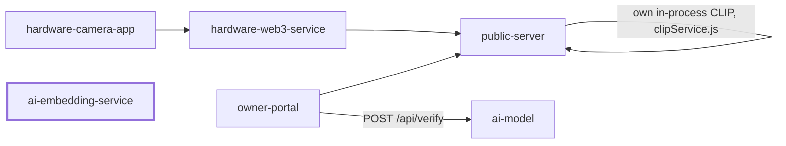
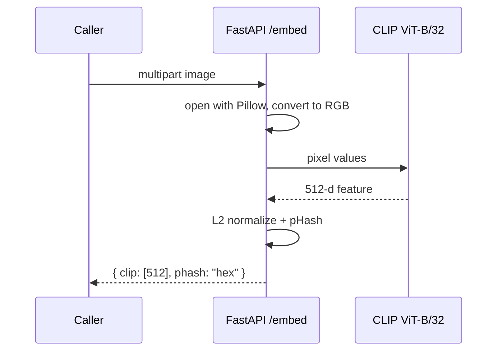

# ai-embedding-service

A tiny FastAPI service that turns an image into a CLIP vector and a pHash string.

## What it does

- Takes one image upload at `POST /embed`.
- Returns a 512-number CLIP embedding (unit length) and a 64-bit pHash.
- Uses `openai/clip-vit-base-patch32` from Hugging Face.
- Runs on GPU if CUDA is there, else CPU.
- Has no database and no state. It only computes vectors.
- The vectors are meant for reverse image search and duplicate checks.

> Heads up: no service in this repo calls it today. See "Where it fits".

## Where it fits



- `ai-embedding-service` is a standalone sidecar. Nothing in the code points to it right now.
- `SYSTEM_ARCHITECTURE.md` draws it as `hardware-web3-service -> :5001`, but no `EMBEDDING_SERVICE_URL` exists in the code.
- `public-server/clipService.js` does the same job in Node (ONNX CLIP) when `ENABLE_CLIP=1`.
- For "is this photo fake?" the portal uses [`ai-model`](../ai-model/README.md) instead.

## Flow



- Cosine similarity of two vectors is just their dot product, since both are unit length.
- Close CLIP vectors mean the same scene or content, even after edits.
- A small pHash distance means near-identical pixels (resize, re-compress).

## Folder structure

```
ai-embedding-service/
  main.py            # the whole API: /health and /embed
  requirements.txt   # python deps
  test.py            # NOT a test: makes the VERIS fair poster (SVG to PDF/PNG)
```

## Tech stack

| Part | Choice |
|------|--------|
| API | FastAPI + Uvicorn |
| Model | CLIP `openai/clip-vit-base-patch32` (transformers, torch) |
| Perceptual hash | `imagehash` pHash, 8x8 |
| Images | Pillow |

## Key code

Embedding is the vision tower plus projection, then normalized:

```python
def _clip_embedding(img: Image.Image) -> list[float]:
    pixel_values = _processor(images=img, return_tensors="pt").pixel_values.to(DEVICE)
    with torch.no_grad():
        vision_out = _model.vision_model(pixel_values=pixel_values)
        feat = _model.visual_projection(vision_out.pooler_output)
    feat = F.normalize(feat, p=2, dim=1)
    return feat[0].cpu().tolist()
```

The pHash is one line:

```python
def _phash(img: Image.Image) -> str:
    return str(imagehash.phash(img, hash_size=8))
```

Bad uploads get a clean 400:

```python
try:
    img = Image.open(io.BytesIO(contents)).convert("RGB")
except Exception as e:
    return JSONResponse(status_code=400, content={"error": f"Cannot read image: {e}"})
```

## API

| Method | Path | Body | Returns |
|--------|------|------|---------|
| GET | `/health` | none | `{ "status": "ok", "device": "cpu" }` |
| POST | `/embed` | multipart field `image` | `{ "clip": [512 floats], "phash": "hex" }` |

```bash
curl -F "image=@photo.jpg" http://localhost:5001/embed
```

## Environment variables

- None. The model id and device are set in `main.py`.

## Setup and run

```bash
cd ai-embedding-service
python3 -m venv .venv && source .venv/bin/activate
pip install -r requirements.txt
uvicorn main:app --port 5001
```

- First start downloads the CLIP weights (hundreds of MB).
- Port 5001 clashes with `public-server`'s default. Use `--port 5002` if both run.

## Testing

- No automated tests for the API.
- `test.py` is a poster script (needs `cairosvg`, writes to `/mnt/user-data/outputs`). Do not run it as a test.
- Smoke test: start the server, then `curl http://localhost:5001/health`.

> TODO: add real pytest tests for `/embed` (a valid image and a corrupt file).

## Troubleshooting

- Slow first request: model is loading. Wait for "CLIP model ready."
- `Cannot read image` (400): the upload is not a valid image file.
- Out of memory on small hosts: CLIP is large. Use a bigger box.
- Port already in use: pick another with `--port`.

## Tracks and sponsors used

| Sponsor | What we built | Files | Fallback or flag |
|---------|---------------|-------|------------------|
| None | Plain CLIP + pHash API, no sponsor SDK | `ai-embedding-service/main.py` | none |

- Grep found no Arkiv, 0G, Arc, Filecoin, Solana, vlayer, RISC Zero or Privy code here.
- Before the event or at the event: not clear from the code.

> TODO: confirm if this service is part of any sponsor submission. It is not wired to any other service today.

## Screenshots

<!-- TODO: screenshot of curl /embed response (save to docs/img/embed-response.png) -->
> 📸 TODO: add screenshot of a `/embed` response

## Siblings

- [ai-model](../ai-model/README.md) - multi-signal photo verifier
- [public-server](../public-server) - claim server, has its own CLIP search
- [hardware-web3-service](../hardware-web3-service) - upload, proofs, minting
- [owner-portal](../owner-portal) - web dashboard
