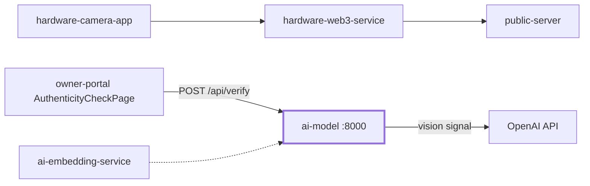
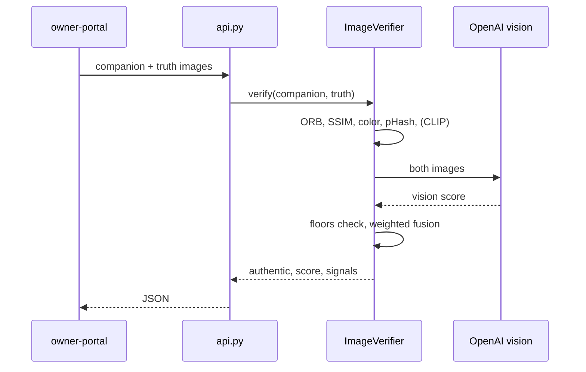

# ai-model

Checks if a candidate photo is the same real scene as a hardware-signed photo.

## What it does

- Compares a candidate photo against a trusted "truth" photo from the Veris camera.
- Runs 5 local signals plus 1 OpenAI vision judgment.
- Fuses them with weights, plus a minimum floor per signal.
- Returns `authentic`, a score, a confidence, and every signal value.
- Serves this over HTTP for the owner-portal.
- Can catch composites (a person pasted into a real background) via the vision signal.

## Where it fits



- The portal calls it at `VITE_VERIFY_API_URL` (default `http://localhost:8000`).
- It does not touch the blockchain or Filecoin.

## Flow



## Training or model artifacts

- There is no training. No weights are saved in this folder.
- CLIP (`openai/clip-vit-base-patch32`) is downloaded from Hugging Face on first use, only if `ENABLE_CLIP=1`.
- Weights and floors are hand-set in `SIGNAL_CONFIG` and tuned on `data/`.
- `calibrate()` picks a threshold from the sample scenes.

## Folder structure

```
ai-model/
  main.py            # signals + ImageVerifier + diagnose/calibrate script
  api.py             # FastAPI wrapper (/health, /api/verify)
  run.py             # small runner script
  test_signals.py    # pytest tests for each signal and the verifier
  requirements.txt   # python deps
  .env.example       # OpenAI key template
  data/              # sample scene_001..scene_011 image pairs
```

## Tech stack

| Part | Choice |
|------|--------|
| API | FastAPI + Uvicorn |
| Classic CV | OpenCV (ORB), scikit-image (SSIM) |
| Hashing | imagehash (pHash) |
| Semantic | CLIP via transformers + torch (optional) |
| Vision judge | OpenAI client |

## Key code

Each signal has a weight and a floor. Below the floor means instant reject:

```python
SIGNAL_CONFIG = {
    "orb":           {"weight": 0.05, "floor": 0.00},
    "ssim_edge":     {"weight": 0.15, "floor": 0.10},
    "color_hist":    {"weight": 0.15, "floor": 0.05},
    "clip":          {"weight": 0.20, "floor": 0.40},
    "phash":         {"weight": 0.15, "floor": 0.20},
    "vision": {"weight": 0.30, "floor": 0.35},
}
```

pHash score is 1 minus the normalized Hamming distance:

```python
h1 = imagehash.phash(img1, hash_size=hash_size)
h2 = imagehash.phash(img2, hash_size=hash_size)
max_dist = hash_size * hash_size  # 64 for hash_size=8
dist = h1 - h2  # hamming distance
return float(1.0 - (dist / max_dist))
```

If vision was asked for but did not run, it rejects instead of guessing:

```python
forensic_unavailable = self.use_openai and "vision" not in signals
if forensic_unavailable and rejected_by is None:
    rejected_by = "vision_unavailable"
```

## API

| Method | Path | Body | Returns |
|--------|------|------|---------|
| GET | `/health` | none | status, `vision_signal_enabled`, `clip_signal_enabled` |
| POST | `/api/verify` | multipart `companion`, `truth` (images) | `authentic`, `score`, `confidence`, `threshold`, `rejected_by`, `signals` |

- Default threshold is 0.45. Confidence is "high" at 0.85 and up.
- Non-image uploads get a 400.

## Environment variables

| Name | Purpose | Example |
|------|---------|---------|
| `OPENAI_API_KEY` | Enables the vision signal | `sk-...` |
| `OPENAI_VISION_MODEL` | Vision model name | see `.env.example` |
| `ENABLE_CLIP` | Set `1` to load CLIP (needs RAM) | `1` |
| `CORS_ORIGINS` | Comma list of allowed origins (default: any localhost port) | `https://portal.example.com` |
| `PORT` | Port when run via `python api.py` | `8000` |

## Setup and run

```bash
cd ai-model
python3 -m venv .venv && source .venv/bin/activate
pip install -r requirements.txt
cp .env.example .env   # then add your OpenAI key
uvicorn api:app --host 0.0.0.0 --port 8000
```

Reproduce the sample scores and threshold:

```bash
python main.py
```

## Testing

```bash
pytest test_signals.py
```

- Tests use the sample pairs in `data/`.
- OpenAI and CLIP tests need a key or `ENABLE_CLIP=1`.

## Troubleshooting

- `vision_unavailable` in `rejected_by`: set `OPENAI_API_KEY`, or the API call failed.
- `clip_signal_enabled: false`: set `ENABLE_CLIP=1` and install torch.
- Browser CORS error: set `CORS_ORIGINS` to your portal origin.
- Out of memory on small hosts: leave CLIP off (default).

## Tracks and sponsors used

| Sponsor | What we built | Files | Fallback or flag |
|---------|---------------|-------|------------------|
| None of the listed ones | Photo check with CV signals + OpenAI vision | `ai-model/main.py`, `ai-model/api.py` | `OPENAI_API_KEY`, `ENABLE_CLIP` |

- Grep found no Arkiv, 0G, Arc, Filecoin, Solana, vlayer, RISC Zero or Privy code here.
- Before the event or at the event: not clear from the code.

> TODO: the vision signal uses the OpenAI client directly. If it was meant to go through the 0G Router, that is not wired up here.

## Screenshots

<!-- TODO: screenshot of the portal authenticity check result (save to docs/img/ai-verify-result.png) -->
> 📸 TODO: add screenshot of the portal authenticity check result

## Siblings

- [ai-embedding-service](../ai-embedding-service/README.md) - CLIP + pHash vectors
- [owner-portal](../owner-portal) - calls `/api/verify`
- [public-server](../public-server) - claim server
- [hardware-web3-service](../hardware-web3-service) - upload and minting
