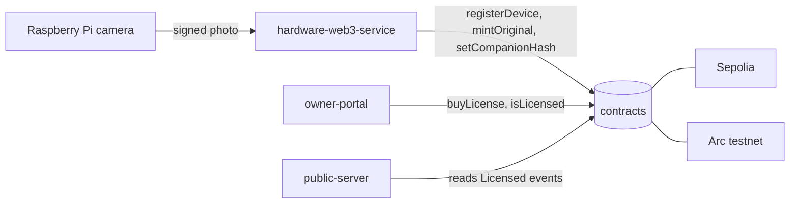
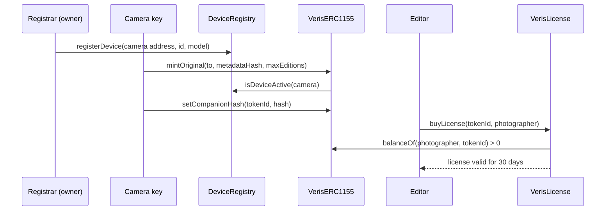

# Veris Contracts

Solidity contracts that register cameras, mint photo NFTs and sell USDC licenses.

> Current on-chain code is **Solidity + Foundry** (Sepolia and Arc testnet).
> There is **no Solana / Anchor program in this repo**. Some project notes mention one.
> TODO: confirm where (or if) the Solana program lives. No `Anchor.toml` or `programs/` folder exists here.

## What it does

- `DeviceRegistry` keeps the list of trusted cameras. Only the owner can add one.
- `VerisERC1155` mints one original NFT per photo, only from a registered camera.
- Editions of an original are minted as separate token ids that point back to it.
- The camera can anchor the hash of its companion (phone) photo once per original.
- `VerisLicense` lets an editor pay 5 USDC for a 30 day license on Arc.
- Photo metadata stays off-chain. Only a hash is stored on-chain, which keeps gas low.

## Where it fits



## Flow



## Folder structure

```
contracts/
  src/
    DeviceRegistry.sol     # trusted camera list (owner-only writes)
    VerisERC1155.sol       # originals + editions + companion hash
    VerisLicense.sol       # 5 USDC / 30 day license on Arc
  script/
    Deploy.s.sol           # deploys registry + NFT, writes deployment-<chainId>.json
    DeployAndVerify.s.sol  # same, driven by NETWORK env var
    RegisterDevice.s.sol   # registers one camera in the registry
  test/                    # 6 Foundry test files, 20 tests
  deployment-<chainId>.json  # addresses used by the backend and portal
  foundry.toml             # solc 0.8.24, via_ir, cancun
  package.json             # legacy submit-proof script (see Troubleshooting)
```

## Tech stack

| Layer | Tech |
|-------|------|
| Language | Solidity 0.8.24 |
| Toolchain | Foundry (forge, cast) |
| Libraries | OpenZeppelin (ERC1155, Ownable, SafeERC20), forge-std |
| Networks | Sepolia (11155111), Arc testnet (5042002), Base Sepolia (84532) allowed |
| Payments | USDC ERC-20 interface on Arc |

## Deployed addresses (testnets, public)

| Contract | Sepolia | Arc testnet |
|----------|---------|-------------|
| DeviceRegistry | `0x7e6bd8193E9762430ff6E494764D74036E333c14` | `0x7e6bd8193E9762430ff6E494764D74036E333c14` |
| VerisERC1155 | `0xA1B6ea0133da15dCFB5A5b4704022e4041f3Edb9` | `0xB7909d4bba142AfF48aF7509B070e64eC1c6AdAc` |
| VerisLicense | not deployed | `0xA1B6ea0133da15dCFB5A5b4704022e4041f3Edb9` |

- Source: `deployment-11155111.json` and `deployment-5042002.json`.
- `deployment.json` is an older Sepolia deploy that still uses the old `CandidERC1155` name.
- Arc USDC (ERC-20 interface) is `0x3600000000000000000000000000000000000000`, as used in `owner-portal/src/lib/arc.js`.

## Key code

Only a registered camera can mint:

```solidity
require(
    deviceRegistry.isDeviceActive(msg.sender),
    "Device not registered or inactive"
);
```

The companion photo hash can be set once, and only by the minting camera:

```solidity
require(msg.sender == m.deviceAddress, "Only the minting device");
require(companionHash[_tokenId] == bytes32(0), "Companion hash already set");
```

The license payee must really hold the original, so money cannot go to a random wallet:

```solidity
require(photos.balanceOf(photographer, tokenId) > 0, "Payee does not hold the original");
```

Buying again while a license runs adds a full term on top:

```solidity
uint64 start = current > block.timestamp ? current : uint64(block.timestamp);
expiresAt = start + TERM;
```

## Contract API

| Contract | Function | Who can call | What it does |
|----------|----------|--------------|--------------|
| DeviceRegistry | `registerDevice(...)` | owner | Adds a camera |
| DeviceRegistry | `updateDevice`, `deactivateDevice` | see source | Edit or disable a camera |
| DeviceRegistry | `getDevice`, `isDeviceActive`, `getAllDevices` | anyone | Read camera info |
| DeviceRegistry | `transferOwnership` | owner | Hands over the registrar role |
| VerisERC1155 | `mintOriginal(to, metadataHash, maxEditions)` | active camera | Mints the original |
| VerisERC1155 | `mintEdition(to, originalId)` | anyone | Mints an edition up to `maxEditions` |
| VerisERC1155 | `batchMintEditions(...)` | anyone | Mints many editions at once |
| VerisERC1155 | `setCompanionHash(id, hash)` | minting camera, once | Anchors the phone photo hash |
| VerisERC1155 | `setBaseURI` | owner | Changes the metadata base URL |
| VerisLicense | `buyLicense(tokenId, photographer)` | anyone with USDC | Pays 5 USDC, 30 day term |
| VerisLicense | `isLicensed(tokenId, licensee)` | anyone | Checks a live license |

Events: `DeviceRegistered`, `TokenMinted`, `EditionMinted`, `CompanionHashSet`, `Licensed`.

## Environment variables

Put these in `contracts/.env` (gitignored). Never commit real keys.

| Name | Used by | Purpose | Example |
|------|---------|---------|---------|
| `PRIVATE_KEY` | all scripts | Deployer / registrar key | `0x...` (hidden) |
| `NETWORK` | DeployAndVerify | Label for the output file | `arc` |
| `BASE_URI` | DeployAndVerify | Metadata base URL (optional) | `https://ipfs.io/ipfs/` |
| `DEVICE_REGISTRY_ADDRESS` | RegisterDevice | Registry to write to | `0x7e6b...3c14` |
| `DEVICE_ADDRESS` | RegisterDevice | Camera wallet address | `0x...` |
| `DEVICE_PUBLIC_KEY` | RegisterDevice | Camera public key | `04ab...` |
| `DEVICE_ID`, `CAMERA_ID` | RegisterDevice | Camera ids | `veris-cam-001` |
| `DEVICE_MODEL`, `FIRMWARE_VERSION` | RegisterDevice | Camera info | `Pi 4`, `1.0.0` |
| `SEPOLIA_RPC_URL` | foundry.toml | Sepolia RPC | `https://...` |
| `ETHERSCAN_API_KEY`, `ARCSCAN_API_KEY` | foundry.toml | Contract verification | hidden |

## Setup and run

```bash
cd contracts
forge build
forge test
forge test --match-test test_licenseEndsAfterTerm   # one test

# Deploy (testnets only, the script rejects other chains)
forge script script/Deploy.s.sol --rpc-url arc --broadcast
forge script script/Deploy.s.sol --rpc-url sepolia --broadcast
```

- Deploy writes `deployment-<chainId>.json`. The backend reads it on start.
- `VerisLicense` has no deploy script here. TODO: add one or document how Arc was deployed.

## Testing

- `forge test` runs 20 tests in 6 files. All pass.
- `DeviceRegistryOwner` checks only the owner can register cameras.
- `CompanionHash` checks the set-once rule.
- `VerisLicense` checks price, term, stacking and the payee check.
- `GasReport` prints gas for register and mint calls.
- `DeploymentJson` checks the deployment files parse.

## Tracks & sponsors used

Before the event: DeviceRegistry, VerisERC1155 (Sepolia). Added at the event: Arc deployment and VerisLicense (commit "Add USDC photo licensing contract and Arkiv license records").

| Sponsor | What we built | Files | Fallback or flag |
|---------|---------------|-------|------------------|
| Arc | Contracts deployed on Arc testnet; USDC license contract | `src/VerisLicense.sol`, `deployment-5042002.json`, `owner-portal/src/lib/arc.js` | Sepolia stays primary; `CHAINS=arc` in `hardware-web3-service` adds Arc |
| Arkiv | Not in this folder; mirrors `Licensed` events as `veris-license` entities | `public-server/arkivService.js` | `ARKIV_ENABLED` (public-server) |
| Solana | > TODO: no Solana program found in this repo | none | none |
| Filecoin / Lighthouse | Not in contracts; metadata hash points at IPFS | `hardware-web3-service/filecoinService.js` | `STORAGE_PROVIDER` |
| 0G | Not in contracts; storage and vision live in services | `hardware-web3-service/zerogStorageService.js` | `STORAGE_PROVIDER=0g` |
| Privy | Not in contracts; wallet login in the portal | `hardware-web3-service/privyService.js` | > TODO: confirm env flag |
| vlayer / RISC Zero | > TODO: old verifier scripts were deleted; no verifier contract in `src/` | none | none |

## Troubleshooting

- `npm run submit-proof` fails: `scripts/submitProof.ts` was deleted, the script is legacy.
- Deploy says "Testnet only": use chain 11155111, 5042002 or 84532.
- `registerDevice` reverts "Only owner": use the deployer key as `PRIVATE_KEY`.
- Forge cannot find OpenZeppelin: `lib/` is gitignored, run `forge install` to restore it.
- `buyLicense` reverts: approve USDC to the license contract first, and pay a wallet that holds the original.

## Screenshots

<!-- TODO: screenshot of forge test passing (save to docs/img/contracts-tests.png) -->
> 📸 TODO: add screenshot of forge test passing

<!-- TODO: screenshot of VerisLicense on ArcScan (save to docs/img/arcscan-license.png) -->
> 📸 TODO: add screenshot of VerisLicense on ArcScan

## Related services

- [hardware-web3-service](../hardware-web3-service) mints and registers cameras
- [public-server](../public-server) reads license events and mirrors them to Arkiv
- [owner-portal](../owner-portal) sells licenses with `buyLicense`
- [hardware-camera-app](../hardware-camera-app) holds the camera key
- [Root README](../README.md)
