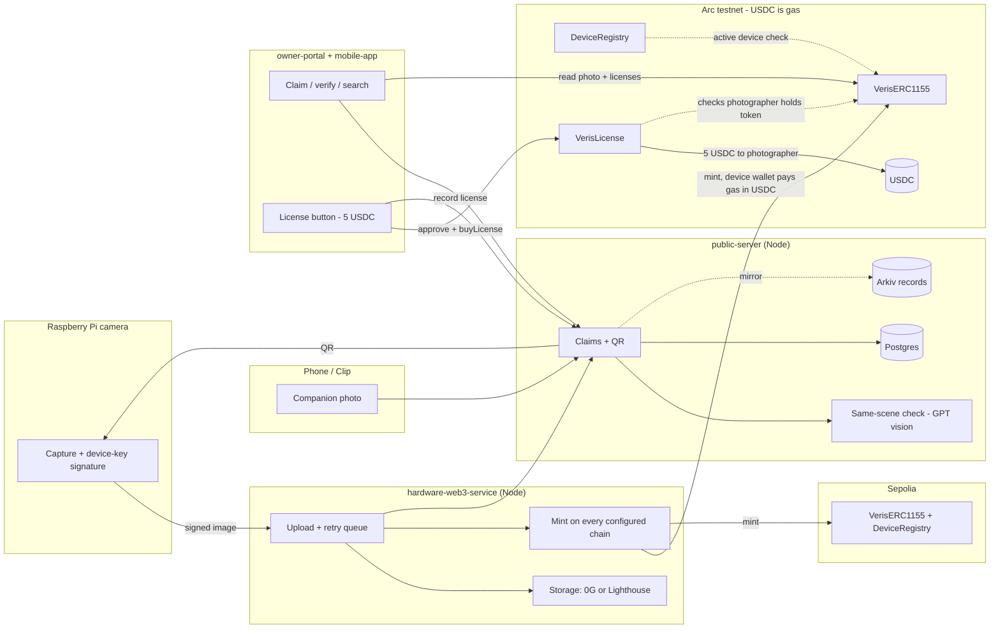
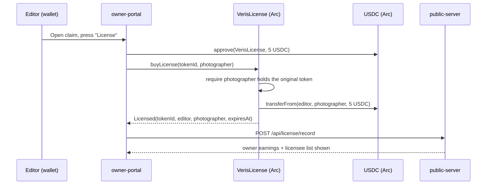

# Veris architecture

Veris turns a camera shot into a hardware-signed photo NFT. Arc is where the photo is
minted and where editors pay the photographer in USDC to license it.

## System

## License flow (the Arc / USDC part)

## Fallbacks

Capture never waits on a third party: capture, sign and queue always succeed locally.
Storage falls back 0G to Lighthouse, claim lookup falls back Arkiv to Postgres, and if Arc
is down the Sepolia mint still completes and the Arc mint is retried.
