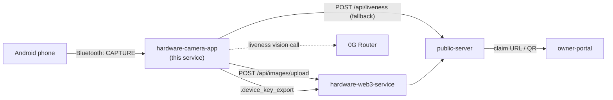
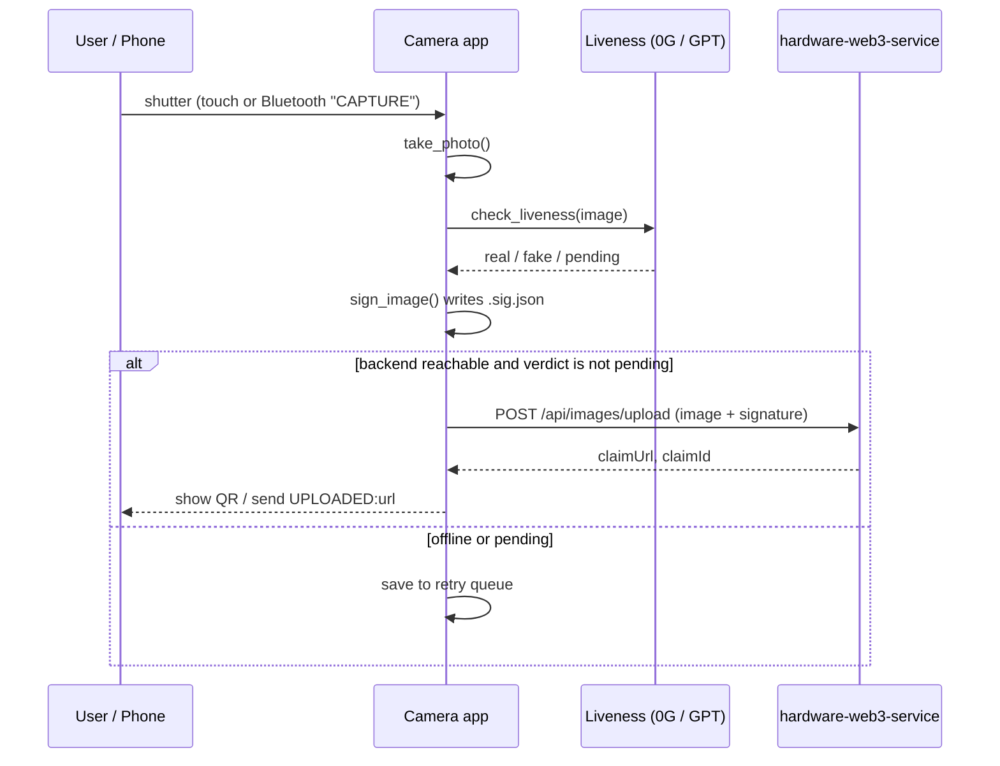

# Veris Camera App

The Raspberry Pi camera that takes a photo, signs it with a hardware-derived key, and sends it to Veris.

## What it does

- Captures photos (and video) with Picamera2 on a Raspberry Pi.
- Derives a secp256k1 device key from Pi hardware IDs plus a stored salt.
- Runs a liveness check (0G Router first, GPT via the public server as fallback) before signing.
- Signs a packet: image hash, verdict, timestamp, nonce, device address (EIP-191 personal_sign).
- Uploads the photo and signature to `hardware-web3-service`, which returns a claim URL.
- Shows the claim QR on the touchscreen app, or reports the URL back to a phone over Bluetooth.
- Queues captures on disk when offline or when no AI engine answers, then retries later.

## Tracks & sponsors used

| Sponsor                  | What we built                                              | Files                                | Fallback or flag                                                                                               |
| ------------------------ | ---------------------------------------------------------- | ------------------------------------ | -------------------------------------------------------------------------------------------------------------- |
| 0G (Router vision + TEE) | Liveness check asks a 0G vision model if the scene is real | `liveness.py`, `capture_pipeline.py` | `ZEROG_ENABLED`, `ZEROG_API_KEY`, `ZEROG_MODEL`, `ZEROG_VERIFY_TEE`; falls back to GPT via `PUBLIC_SERVER_URL` |

- Added at the event: the liveness check (0G plus GPT fallback). The signing and upload parts were there before.
- The result (engine, request id, `tee_verified`) is kept in the signed packet's `liveness` field.
- > TODO: 0G Storage is not used by this service.
- Arkiv, Arc, Filecoin/Lighthouse/Synapse, Solana, vlayer, RISC Zero and Privy are not in this service's code. They live in the sibling services.

## Where it fits



## Flow



## Folder structure

```
hardware-camera-app/
├── raspberry_pi_camera_app.py   # Kivy touchscreen app (preview, shutter, QR overlay)
├── headless_camera_app.py       # No-screen entrypoint, shutter via Bluetooth
├── capture_pipeline.py          # Camera control, signing, upload, retry queue
├── hardware_identity.py         # Device key derivation and signing
├── liveness.py                  # 0G / GPT real-or-fake check
├── export_key.py                # Writes .device_key_export for the backend
├── bt_trigger_server.py         # Bluetooth SPP server that receives CAPTURE
├── bt_tether.py                 # Bluetooth PAN tethering for phone data
├── stream_server.py             # MJPEG preview stream on port 8081
├── test_signing.py              # Python signature must verify in ethers.js
├── test_pipeline.py             # Pending then resumed upload check
├── install.sh / install_dependencies.sh / fix_picamera2.sh
├── run_camera_app.sh            # Starts backend, ngrok, then the Kivy app
├── kiosk-start.sh               # Chromium kiosk launcher
├── headless-camera@.service     # systemd unit for headless mode
└── .env.example                 # Per-Pi settings
```

## Tech stack

| Part           | Tech                                            |
| -------------- | ----------------------------------------------- |
| Language       | Python 3                                        |
| UI             | Kivy (touchscreen)                              |
| Camera         | Picamera2                                       |
| Crypto         | `ecdsa` (secp256k1), keccak256 for the address  |
| HTTP           | `requests`                                      |
| QR             | `qrcode`                                        |
| Bluetooth      | `pybluez2` (RFCOMM/SPP), `bt-pan` for tethering |
| EXIF           | `piexif` (timezone offset stamp)                |
| Run as service | systemd                                         |

## Key code snippets

The exact text the device signs. The backend rebuilds it to recover the signer.

```python
def build_packet_message(image_hash, companion_hash, verdict, timestamp, nonce, device_address):
    return "\n".join([
        "veris-capture-v1",
        f"image:{image_hash}",
        f"companion:{companion_hash or '-'}",
        f"verdict:{verdict or 'pending'}",
        f"ts:{timestamp}",
        f"nonce:{nonce}",
        f"device:{device_address.lower()}",
    ])
```

The device key comes from hardware IDs plus a salt, so it never leaves the Pi unless exported.

```python
def _derive_key(self, hw_id, salt):
    combined = hw_id + salt
    seed = hashlib.sha256(combined).digest()
    private_key = SigningKey.from_string(seed, curve=SECP256k1)
```

The Ethereum-style address is the last 20 bytes of keccak256 of the public key.

```python
def _get_address(self):
    return "0x" + _keccak256(self.public_key.to_string())[-20:].hex()
```

No AI answer means "pending". The capture is parked, never guessed.

```python
if signature_info.get('verdict') == 'pending':
    status_callback('Pending -- Will Verify Later', 'warning', 4)
    _enqueue_pending(filename, signature_info, camera_id, stage='liveness')
    return {'status': 'pending'}
```

## Interfaces

Calls this app makes:

| Target              | Call                      | Purpose                                        |
| ------------------- | ------------------------- | ---------------------------------------------- |
| `BACKEND_URL`       | `GET /health`             | Check the backend is up                        |
| `BACKEND_URL`       | `POST /api/images/upload` | Send image, signature, hash, verdict, location |
| `PUBLIC_SERVER_URL` | `POST /api/liveness`      | GPT liveness fallback                          |
| `ZEROG_BASE_URL`    | `POST /chat/completions`  | 0G vision liveness check                       |
| ip-api.com          | `GET /json`               | Rough location for the capture                 |

Bluetooth protocol (headless mode):

| Direction   | Message                                                                     |
| ----------- | --------------------------------------------------------------------------- |
| Phone to Pi | `CAPTURE`                                                                   |
| Pi to phone | `CAPTURING`, `CAPTURED`, `SIGNED`, `TETHERING`, `UPLOADING`                 |
| Pi to phone | `UPLOADED:<claim_url>`, `QUEUED:offline`, `QUEUED:pending`, `FAILED:<step>` |

Other: the MJPEG preview from `stream_server.py` is at `http://<pi>:8081/stream`.

## Environment variables

Copy `.env.example` to `.env` on each Pi. Never commit real values.

| Name                                                 | Purpose                              | Example                                                 |
| ---------------------------------------------------- | ------------------------------------ | ------------------------------------------------------- |
| `BACKEND_URL`                                        | hardware-web3-service address        | `http://localhost:5000`                                 |
| `CAPTURE_DIR`                                        | Where photos are saved               | `/home/pi/captures`                                     |
| `DEVICE_ID`                                          | Short id, used in the Bluetooth name | `pi01`                                                  |
| `BT_DEVICE_NAME`                                     | Override Bluetooth name              | `Veris-Cam-pi01`                                        |
| `PHONE_MAC`                                          | Paired phone for PAN tethering       | `AA:BB:CC:DD:EE:FF`                                     |
| `TETHER_TIMEOUT`                                     | Seconds to wait for a DHCP lease     | `10`                                                    |
| `RETRY_INTERVAL`                                     | Seconds between offline retries      | `300`                                                   |
| `CAMERA_ROTATION`                                    | Frame rotation in degrees            | `-90`                                                   |
| `PREVIEW_SIZE` / `PHOTO_SIZE` / `VIDEO_SIZE`         | Resolutions as `w,h`                 | `1920,1080`                                             |
| `PREVIEW_FRAMERATE`                                  | Preview fps                          | `30`                                                    |
| `VIDEO_BITRATE`                                      | H264 bitrate                         | `10000000`                                              |
| `MIN_ZOOM` / `MAX_ZOOM` / `ZOOM_STEP`                | Digital zoom limits                  | `1.0` / `4.0` / `0.5`                                   |
| `CAMERA_INDEX`                                       | Which camera to open                 | `0`                                                     |
| `SHOW_CURSOR` / `KIVY_FULLSCREEN` / `KIVY_LOG_LEVEL` | Kivy display settings                | `true` / `auto` / `info`                                |
| `CLAIM_POLL_INTERVAL`                                | Kivy claim polling, seconds          | `5`                                                     |
| `SALT_PATH`                                          | Where the device salt lives          | `/boot/.device_salt`                                    |
| `SALT_BACKUP_PATH`                                   | Salt backup location                 | `/home/pi/.veris/.device_salt_backup`                   |
| `DEVICE_KEY_EXPORT_PATH`                             | Where the key export is written      | `/home/pi/Veris/hardware-camera-app/.device_key_export` |
| `ZEROG_ENABLED`                                      | Turn on 0G liveness                  | `false`                                                 |
| `ZEROG_API_KEY`                                      | 0G Router key                        | `<your-key>`                                            |
| `ZEROG_MODEL`                                        | 0G vision model name                 | `<model-name>`                                          |
| `ZEROG_BASE_URL`                                     | 0G Router URL                        | `https://router-api.0g.ai/v1`                           |
| `ZEROG_VERIFY_TEE`                                   | Ask 0G for TEE verification          | `false`                                                 |
| `PUBLIC_SERVER_URL`                                  | Server for the GPT fallback          | `https://api.veris.live`                                |
| `DEVICE_API_SECRET`                                  | Auth for `/api/liveness`             | `<secret>`                                              |

## Setup and run

On a Raspberry Pi:

```bash
cd hardware-camera-app
./install_dependencies.sh        # apt and pip packages, makes a venv
cp .env.example .env             # then edit BACKEND_URL, DEVICE_ID, etc.
```

Export the device key for the backend (the Kivy app also does this on start):

```bash
python3 export_key.py            # or: python3 export_key.py <camera_id>
```

Touchscreen mode:

```bash
python3 raspberry_pi_camera_app.py
# or start backend + tunnel + app together
./run_camera_app.sh
```

Headless mode (Bluetooth shutter):

```bash
python3 headless_camera_app.py
# as a service
sudo systemctl enable --now headless-camera@$USER
```

> TODO: confirm the venv path `install_dependencies.sh` creates (the service file expects `~/camera-env`).

## Testing

```bash
cd hardware-camera-app
python3 test_signing.py    # needs node and hardware-web3-service deps (ethers)
python3 test_pipeline.py   # needs numpy and opencv
```

- `test_signing.py` checks 20 signatures recover to the device address in ethers.js.
- `test_signing.py` also checks the Python and JS packet text match.
- `test_pipeline.py` checks "no AI answer" gives `pending`, then resumes and uploads.

## Troubleshooting

- Camera busy or missing: stop other apps using Picamera2; the key needs the camera id, so the app refuses to sign with a guess.
- Wrong device address: use the key from `.device_key_export`, not a re-derived one.
- Captures stuck as pending: set `ZEROG_*` or make sure `PUBLIC_SERVER_URL` and `DEVICE_API_SECRET` are right.
- Upload says offline: check `BACKEND_URL` and `GET /health`; queued items retry every `RETRY_INTERVAL` seconds.
- No Bluetooth trigger: pair and trust the phone with `bluetoothctl`, and install `pybluez2`.

## Related services

- [hardware-web3-service](../hardware-web3-service/) receives uploads and creates claims.
- [public-server](../public-server/) hosts claims and the GPT liveness fallback.
- [owner-portal](../owner-portal/) is where users scan the QR and claim.
- [contracts](../contracts/) holds on-chain device and NFT logic.
