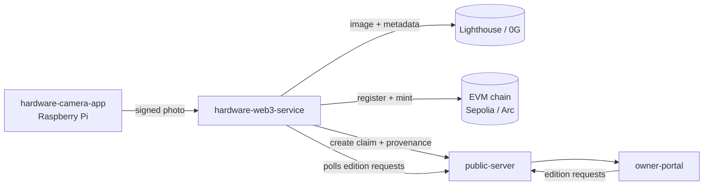
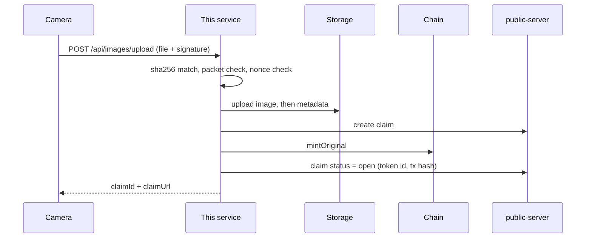

# hardware-web3-service

The backend that turns a signed Pi photo into a stored, minted, claimable proof.

## What it does

- Receives a signed photo from the camera at `POST /api/images/upload`.
- Checks the hash, the device signature, the timestamp and the nonce (replay guard).
- Uploads the image and metadata to Lighthouse (Filecoin) or 0G, with fallback.
- Registers the device and mints the original NFT (ERC-1155) through `ethers`.
- Creates a claim on `public-server` and returns a claim URL and QR link to the camera.
- Retries stuck photos in the background and mirrors mints to a second chain (Arc) if enabled.

> TODO: ZK proof (vlayer), Solana and Arkiv are not in this service's code. Judges: check `public-server` and `contracts` for those parts.

## Where it fits



## Architecture / flow



## Folder structure

```
hardware-web3-service/
├── server.js            # Express app, all routes, startup, retry sweeps
├── web3Service.js       # ethers: device registry + ERC-1155 mint
├── chains.js            # primary + secondary chains (sepolia, base-sepolia, arc)
├── storageService.js    # picks Lighthouse or 0G, falls back to the other
├── filecoinService.js   # Lighthouse upload
├── zerogStorageService.js # 0G upload
├── packet.js            # signed packet message + verification
├── claimClient.js       # HTTP client for public-server
├── provenance.js        # pushes full capture record to the claim page
├── decisionLog.js       # liveness decision log stored per photo
├── dbService.js         # SQLite (better-sqlite3) tables
├── privyService.js      # Privy session signer + mint with signer
├── getHardwareKey.js    # reads the device key via the camera app's Python
├── deploymentService.js # reads deployment.json contract addresses
├── chains.test.js       # node:test tests
└── hardware-web3-service@.service  # systemd unit for the Pi
```

## Tracks & sponsors used

| Sponsor | What we built | Files | Fallback or flag |
|---------|---------------|-------|------------------|
| Filecoin (Lighthouse) | Uploads the photo and metadata to IPFS/Filecoin | `filecoinService.js`, `storageService.js` | `LIGHTHOUSE_API_KEY`; default store, before the event |
| 0G Storage | Stores photo, metadata and the liveness decision log on 0G | `zerogStorageService.js`, `storageService.js`, `decisionLog.js` | `STORAGE_PROVIDER=0g` makes it primary; falls back to Lighthouse; added at the event |
| 0G Router vision / TEE | Keeps the camera's 0G verdict, TEE flag and request id in the decision log | `decisionLog.js`, `provenance.js` | Camera sends `liveness`; this service only stores it |
| Arc (testnet, USDC gas) | Mints the original NFT on Arc as well as the main chain | `chains.js`, `web3Service.js` | `CHAINS=sepolia,arc`, `ARC_RPC_URL`; failed mints are queued and retried; added at the event |
| Privy | Session signer and mint-with-signer routes | `privyService.js`, `server.js` | `PRIVY_APP_ID`, `PRIVY_APP_SECRET`; before the event |
| Arkiv | Not in this service | none | > TODO: Arkiv lives in `public-server/arkivService.js`; this service only sends provenance to public-server |
| Solana | Not in this service | none | > TODO: no Solana code here; this service mints on EVM chains with ethers |
| vlayer / RISC Zero | Not in this service | none | > TODO: no ZK code found here |

> TODO: `@filoz/synapse-sdk` is in `package.json` but no import was found in the service files.

## Tech stack

| Part | Tech |
|------|------|
| Server | Node.js (ES modules), Express 4 |
| Database | SQLite via better-sqlite3 |
| Chain | ethers 6, viem |
| Storage | Lighthouse SDK (Filecoin), 0G Storage SDK, Synapse SDK |
| Auth for mint | Privy server-auth |
| Uploads | multer |

## Key code snippets

The exact message the Pi signs (must match the camera's Python byte for byte):

```js
export function buildPacketMessage({ imageHash, companionHash, verdict, timestamp, nonce, deviceAddress }) {
  return [
    'veris-capture-v1',
    `image:${imageHash}`,
    `companion:${companionHash || '-'}`,
    `verdict:${verdict || 'pending'}`,
    `ts:${timestamp}`,
    `nonce:${nonce}`,
    `device:${String(deviceAddress).toLowerCase()}`,
  ].join('\n');
}
```

The signer must be the device, and a nonce can only be used once:

```js
signer = ethers.verifyMessage(buildPacketMessage(fields), signature);
if (signer.toLowerCase() !== String(deviceAddress).toLowerCase()) {
  return { ok: false, status: 403, error: 'Signature was not made by deviceAddress' };
}
if (seenNonce(nonce)) return { ok: false, status: 409, error: 'Nonce already used' };
```

The bytes we got must be the bytes the device signed:

```js
const receivedHash = crypto.createHash('sha256').update(fs.readFileSync(req.file.path)).digest('hex');
if (receivedHash !== imageHash.toLowerCase()) {
  return reject(400, 'imageHash does not match the uploaded file');
}
```

Storage tries the chosen provider first, then the other:

```js
const primary = process.env.STORAGE_PROVIDER === '0g' ? '0g' : 'lighthouse';
const other = primary === '0g' ? 'lighthouse' : '0g';
return [primary, other].filter((name) => providers[name].initialized);
```

<!-- TODO: screenshot of the server startup log (save to docs/img/hw-service-startup.png) -->
> 📸 TODO: add screenshot of the server startup log

## API endpoints

| Method | Path | Purpose |
|--------|------|---------|
| GET | `/health`, `/status` | Liveness check |
| GET | `/api/status` | Service, chain and storage status |
| GET | `/api/balance` | Device wallet balance per chain |
| GET | `/api/device/status` | Device registration state |
| POST | `/api/device/register` | Register the device on the registry |
| POST | `/api/device/ensure-registered` | Register only if needed |
| POST | `/api/device/update` | Update firmware version / active flag |
| POST | `/api/images/upload` | Main flow: signed photo in, claim out |
| GET | `/api/images/list` | List stored images |
| GET | `/api/images/:id` | One image record |
| GET | `/api/images/:id/photo` | The photo file |
| GET | `/api/verify/:claimId` | Verify a claim |
| POST | `/api/mint-pending` | Mint images that are not minted yet |
| POST | `/api/retry-pending` | Retry stuck images (needs `OWNER_WALLET_ADDRESS`) |
| GET | `/api/claims/check` | Check claims on the claim server |
| POST | `/api/privy/create-session-signer` | Create a Privy session signer |
| POST | `/api/privy/mint-with-signer` | Mint through a Privy signer |
| GET | `/captures/*` | Static saved photos |

> TODO: startup log mentions `/api/proofs/:claim_id` and `/api/proofs/token/:token_id`, but no such route was found in `server.js`.

## Environment variables

Copy `.env.example` to `.env`. Never commit real keys.

| Name | Purpose | Example |
|------|---------|---------|
| `PORT` | Server port (default 5000) | `5000` |
| `CAPTURES_PATH` | Where photos are saved | `./captures` |
| `RPC_URL` | Primary chain RPC | `https://rpc.example` |
| `DEVICE_PRIVATE_KEY` | Device wallet key (else derived from the camera key) | `0x...` (secret) |
| `REGISTRAR_PRIVATE_KEY` | Registry owner key for `registerDevice` | `0x...` (secret) |
| `OWNER_WALLET_ADDRESS` | Wallet that owns the minted originals | `0xabc...` |
| `DEVICE_REGISTRY_ADDRESS`, `VERIS_ERC1155_ADDRESS` | Contract addresses (else from `deployment.json`) | `0x...` |
| `DEPLOYMENT_JSON_PATH` | Custom `deployment.json` path | `./deployment.json` |
| `CHAINS` | Chains to mint on | `sepolia,arc` |
| `SEPOLIA_RPC_URL`, `BASE_SEPOLIA_RPC_URL`, `ARC_RPC_URL` | Per-chain RPC overrides | `https://...` |
| `STORAGE_PROVIDER` | `lighthouse` (default) or `0g` | `lighthouse` |
| `LIGHTHOUSE_API_KEY` | Lighthouse upload key | secret |
| `ZEROG_PRIVATE_KEY`, `ZEROG_EVM_RPC`, `ZEROG_INDEXER_RPC`, `ZEROG_STORAGESCAN_URL` | 0G storage settings | `https://...` |
| `CLAIM_SERVER_URL` | public-server base URL | `https://api.veris.live` |
| `CLAIM_PORTAL_URL` | Portal base URL for claim links | `https://veris.live` |
| `CLAIM_CLIENT_TIMEOUT` | Claim server request timeout | see `claimClient.js` |
| `DEVICE_API_SECRET` | Shared with public-server, sent as `x-device-secret` | secret |
| `DEVICE_API_URL` | Public URL of this service | `https://abc.ngrok.app` |
| `ENFORCE_PACKET` | `false` accepts old unsigned cameras | `true` |
| `PACKET_MAX_AGE_HOURS` | Max age of a signed packet (default 24) | `24` |
| `AUTO_RETRY_INTERVAL_MS` | Retry sweep interval (default 60000) | `60000` |
| `MIN_ETH_BALANCE` | Low gas warning threshold (default 0.01) | `0.01` |
| `CORS_ORIGINS` | Extra allowed browser origins (comma list) | `https://my.app` |
| `DATABASE_PATH` | SQLite file path | `./database/veris.db` |
| `PRIVY_APP_ID`, `PRIVY_APP_SECRET` | Privy server credentials | secret |
| `PYTHON_PATH` | Python used to read the hardware key | `python3` |

> TODO: `BASE_RPC_URL`, `VERIFIER_CONTRACT_ADDRESS` appear in code or example; confirm they are still used.

## Setup and run

```bash
cd hardware-web3-service
npm install
cp .env.example .env     # then fill in the values above
npm run dev              # nodemon
npm run start            # production
```

On the Pi, use the systemd template: `hardware-web3-service@<user>.service`.

## Testing

```bash
node --test chains.test.js   # chain mint rows, packet hash, explorer links
node packet.js               # self-check of packet signing and replay rules
```

## Troubleshooting

- Upload returns 403 "Packet is too old": fix the Pi clock or raise `PACKET_MAX_AGE_HOURS`.
- Upload returns 409 "Nonce already used": that capture was already sent.
- Claim not created: check `CLAIM_SERVER_URL` and that `public-server` is running; the retry sweep tries again.
- Mint fails: device wallet has no gas, check `GET /api/balance`.
- Old cameras rejected: set `ENFORCE_PACKET=false` for testing only.

## Links

- [hardware-camera-app](../hardware-camera-app)
- [public-server](../public-server)
- [owner-portal](../owner-portal)
- [contracts](../contracts)
