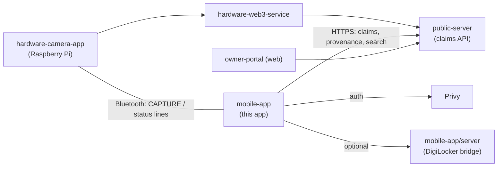
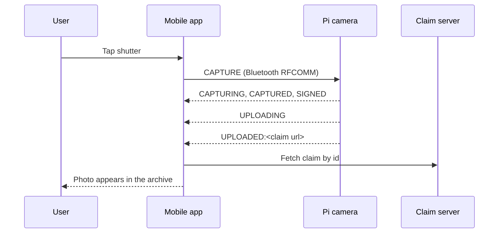

# Veris Mobile App (Hotshoe)

An Expo / React Native app to trigger the Veris camera, browse sealed photos, and verify any image.

## What it does

- Connects to the Raspberry Pi camera over classic Bluetooth and sends a `CAPTURE` command (Android only).
- Shows live pipeline status from the Pi: captured, signed, uploading, uploaded, queued, failed.
- Lists every photo the wallet owns, pulled from the hosted claim server.
- Opens a claim sheet per photo with provenance, chain proof and license history.
- Verifies any image by uploading it for a reverse-image check against sealed photos.
- Checks identity through DigiLocker (via a small bundled server) before wallet connect.

## Where it fits



## Flow: trigger a photo from the phone



## Screens

| Route | File | What it is |
|---|---|---|
| `/` | `src/app/index.tsx` | Redirects to portal if connected, else onboarding |
| `/onboarding` | `src/app/onboarding.tsx` | Intro carousel |
| `/landing` | `src/app/landing.tsx` | Entry: owner portal or verify a photo |
| `/digilocker` | `src/app/digilocker.tsx` | Identity check |
| `/wallet` | `src/app/wallet.tsx` | Wallet connect (modal) |
| `/pairing` | `src/app/pairing.tsx` | Pair a device (modal) |
| `/trigger` | `src/app/trigger.tsx` | Remote shutter for the Pi (modal) |
| `/portal` | `src/app/(app)/portal.tsx` | The archive: grid of sealed photos |
| `/search` | `src/app/(app)/search.tsx` | Search and verify, wallet scoped |
| `/capture` | `src/app/(app)/capture.tsx` | Phone camera capture |
| `/monitor` | `src/app/(app)/monitor.tsx` | Shows age of the newest frame |
| `/profile` | `src/app/(app)/profile.tsx` | Identity, device and settings |
| `/verify` | `src/app/verify.tsx` | Public verify, no wallet needed |
| `/claim/[index]` | `src/app/claim/[index].tsx` | Claim sheet for a seed (demo) photo |
| `/claim/real/[claimId]` | `src/app/claim/real/[claimId].tsx` | Claim sheet for a real Pi-sealed photo |

<!-- TODO: screenshot of onboarding (save to docs/img/onboarding.png) -->
> 📸 TODO: add screenshot of onboarding

<!-- TODO: screenshot of landing (save to docs/img/landing.png) -->
> 📸 TODO: add screenshot of landing

<!-- TODO: screenshot of wallet connect (save to docs/img/wallet.png) -->
> 📸 TODO: add screenshot of wallet connect

<!-- TODO: screenshot of DigiLocker check (save to docs/img/digilocker.png) -->
> 📸 TODO: add screenshot of DigiLocker check

<!-- TODO: screenshot of the portal archive grid (save to docs/img/portal.png) -->
> 📸 TODO: add screenshot of the portal archive grid

<!-- TODO: screenshot of the Pi remote trigger (save to docs/img/trigger.png) -->
> 📸 TODO: add screenshot of the Pi remote trigger

<!-- TODO: screenshot of a real claim sheet with proof panel (save to docs/img/claim.png) -->
> 📸 TODO: add screenshot of a real claim sheet with proof panel

<!-- TODO: screenshot of verify / search result (save to docs/img/verify.png) -->
> 📸 TODO: add screenshot of verify / search result

<!-- TODO: screenshot of profile (save to docs/img/profile.png) -->
> 📸 TODO: add screenshot of profile

## Tracks & sponsors used

Only what this app's code really does. The heavy lifting for each sponsor lives in the sibling services.

| Sponsor | What we built | Files | Fallback or flag |
|---|---|---|---|
| Privy | Login and embedded wallet for the app | `src/app/_layout.tsx`, `src/app/wallet.tsx`, `src/hooks/use-connection.tsx` | IDs hardcoded in `src/constants/config.ts` |
| Arkiv | Provenance shown comes from the server, which reads Arkiv first, then Postgres | `src/app/claim/real/[claimId].tsx` | Server side choice, no app flag |
| 0G | Shows "0G Storage" for `0g` CIDs and "0G Compute" as the checker, with request id | `src/app/claim/real/[claimId].tsx`, `src/constants/config.ts` | Falls back to GPT vision label and Lighthouse gateways |
| Arc (USDC licensing) | License history read from the Arc explorer, 5 USDC for 30 days | `src/components/licenses-card.tsx`, `src/constants/config.ts` | Shows "couldn't reach Arc indexer" on failure |
| Filecoin / Lighthouse | Photos load through Lighthouse IPFS gateways | `src/constants/config.ts` (`IPFS_GATEWAYS`) | Tries the server gateway first, then each Lighthouse subdomain |

> TODO: the Sepolia contract in `config.ts` is still the app's main chain, Solana, vlayer and RISC Zero are not used directly by this app.
> TODO: before the event vs added at the event is not clear from this app's code, confirm with git history.

## Folder structure

```
mobile-app/
├── src/
│   ├── app/            # expo-router screens (see table above)
│   ├── bluetooth/      # Pi link: pi-connection.ts, permissions.ts
│   ├── components/     # shared UI: dock, glass-panel, brutal-block, ...
│   ├── constants/      # config.ts (URLs, chain info), theme, photos seed data
│   ├── hooks/          # state + data: use-pi-trigger, use-wallet-claims, use-claim, ...
│   ├── lib/            # helpers: claim-id, save-photo, wallet-connect, format
│   └── screens/        # search-screen shared by /search and /verify
├── server/             # tiny Express bridge for DigiLocker (Setu)
├── plugins/            # Expo config plugin for Android Bluetooth permissions
├── docs/spec/          # bluetooth.md protocol notes
└── app.json            # Expo config, URL scheme: verishotshoeapp
```

## Tech stack

| Layer | Tech |
|---|---|
| Framework | Expo SDK 57, Expo Router, React 19, React Native 0.86 |
| Motion / gestures | react-native-reanimated, react-native-gesture-handler |
| Auth | Privy (`@privy-io/expo`), WalletConnect, passkeys |
| Chain client | viem |
| Pi link | react-native-bluetooth-classic (Android RFCOMM) |
| Device APIs | expo-camera, expo-image-picker, expo-media-library, expo-secure-store |
| Identity | DigiLocker through Setu, via `server/` (Express) |
| Language | TypeScript |

## Key code snippets

The Pi sends plain text lines. This turns them into typed status events.

```ts
export function parseStatusLine(line: string): PiStatusLine {
  const trimmed = line.trim();

  if (trimmed === 'CAPTURING') return { kind: 'CAPTURING' };
  if (trimmed === 'SIGNED') return { kind: 'SIGNED' };
  if (trimmed.startsWith('UPLOADED:')) {
    return { kind: 'UPLOADED', claimUrl: trimmed.slice('UPLOADED:'.length) };
  }
  // ...
}
```

Only already-paired Pis are used. The device name must start with `Veris-Cam-`.

```ts
async findPairedPi(): Promise<BluetoothDevice | null> {
  const bonded = await RNBluetoothClassic.getBondedDevices();
  const prefix = DEVICE_NAME_PREFIX.toLowerCase();
  return bonded.find((d) => d.name?.toLowerCase().startsWith(prefix)) ?? null;
}
```

Triggering a shot is one line over the socket.

```ts
async sendCapture(): Promise<void> {
  if (!this.device) throw new Error('Not connected');
  await this.device.write('CAPTURE\n');
}
```

The wallet archive is polled from the claim server every 15 seconds.

```ts
const res = await fetch(`${CLAIM_SERVER_URL}/claims/by-wallet/${encodeURIComponent(address)}`);
```

## Backend calls the app makes

All go to `CLAIM_SERVER_URL` (`https://api.veris.live`, set in `src/constants/config.ts`).

| Call | Used for |
|---|---|
| `GET /claims/by-wallet/:address` | Archive for the connected wallet |
| `GET /claims/by-camera/:id` | Claims captured by a paired camera |
| `GET /check-claim?claim_id=` | Load one claim |
| `GET /api/provenance/:claimId` | Provenance and chain proof |
| `POST /claim/:claimId/submit` | Claim a photo |
| `POST /api/search` | Reverse-image verify (multipart upload) |
| `POST /api/companion/upload` | Upload the phone companion photo |
| `POST /api/claim/:claimId/companion/link` | Link companion photo to a claim |
| `GET /api/image/...` | Image gateway, tried before Lighthouse gateways |

## DigiLocker bridge (`server/`)

| Method and path | Purpose |
|---|---|
| `GET /health` | Liveness check |
| `POST /api/digilocker/session` | Start a consent session, returns `authUrl` and `state` |
| `GET /api/digilocker/redirect` | Redirect hop back into the app |
| `POST /api/digilocker/callback` | Finish the session, returns verified, name, doc type |

## Environment variables

App (read in `src/hooks/use-digilocker.tsx`):

| Name | Purpose | Example |
|---|---|---|
| `EXPO_PUBLIC_API_BASE_URL` | Points to `server/`. Unset means a built-in mock verify. | `http://localhost:8787` |

DigiLocker server (`server/.env`, copy from `server/.env.example`):

| Name | Purpose | Example |
|---|---|---|
| `PORT` | Server port | `8787` |
| `SETU_CLIENT_ID` | Setu credential | `your-client-id` |
| `SETU_CLIENT_SECRET` | Setu credential | `your-client-secret` |
| `SETU_PRODUCT_INSTANCE_ID` | Setu product id | `your-instance-id` |
| `SETU_BASE_URL` | Sandbox or prod Setu | `https://dg-sandbox.setu.co` |
| `PUBLIC_SERVER_URL` | Public HTTPS URL of this server | `http://localhost:8787` |
| `APP_DEEP_LINK_SCHEME` | App URL scheme | `verishotshoeapp` |

> TODO: Privy ids, WalletConnect id, contract addresses and chain ids are hardcoded in `src/constants/config.ts`, not env vars.

## Setup & run

```bash
cd mobile-app
npm install
npx expo start            # press i / a / w, or scan with Expo Go
```

Native builds (needed for Bluetooth, Expo Go will not have the native module):

```bash
npm run android           # expo run:android
npm run ios               # expo run:ios (no Pi Bluetooth on iOS)
npm run web               # expo start --web
```

Optional real DigiLocker flow:

```bash
cd server
npm install
cp .env.example .env      # fill in Setu credentials
npm run dev               # listens on :8787
# then start the app with:
EXPO_PUBLIC_API_BASE_URL=http://localhost:8787 npx expo start
```

One-time Pi setup: pair the phone with the Pi in Android Settings first. See `docs/spec/bluetooth.md`.

## Testing

- No automated test suite is set up.
- Lint with `npm run lint`.
- Manual check: pair the Pi, open the trigger screen, press the shutter, watch statuses reach `UPLOADED`.

> TODO: add unit tests, for example for `parseStatusLine` in `src/bluetooth/pi-connection.ts`.

## Troubleshooting

- Trigger says unsupported: Pi Bluetooth works on Android only.
- Pi not found: pair it in Android Settings first, its name must start with `Veris-Cam-`.
- Bluetooth module missing: use a dev build (`npm run android`), not Expo Go.
- DigiLocker always shows a fake user: `EXPO_PUBLIC_API_BASE_URL` is unset, so the mock runs.
- Photo not in the archive: check the Pi reached `UPLOADED` and the claim server is reachable.
- Photo image will not load: gateways in `IPFS_GATEWAYS` (`config.ts`) may be stale after a key rotation.

## Links

- Root: [`../README.md`](../README.md)
- Camera: [`../hardware-camera-app`](../hardware-camera-app)
- Backend: [`../hardware-web3-service`](../hardware-web3-service)
- Claim server: [`../public-server`](../public-server)
- Web portal: [`../owner-portal`](../owner-portal)
- Contracts: [`../contracts`](../contracts)
- DigiLocker bridge notes: [`server/README.md`](server/README.md)
- Bluetooth protocol: [`docs/spec/bluetooth.md`](docs/spec/bluetooth.md)
