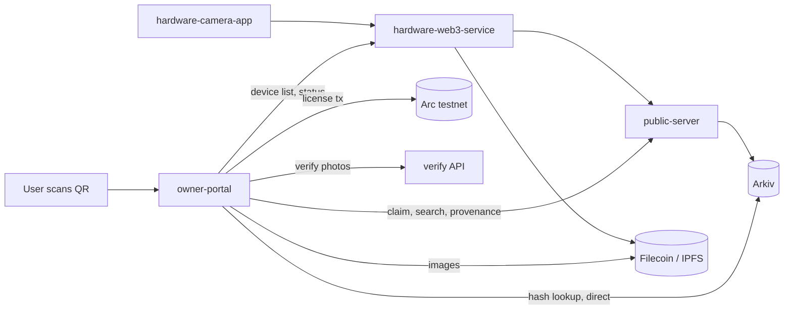
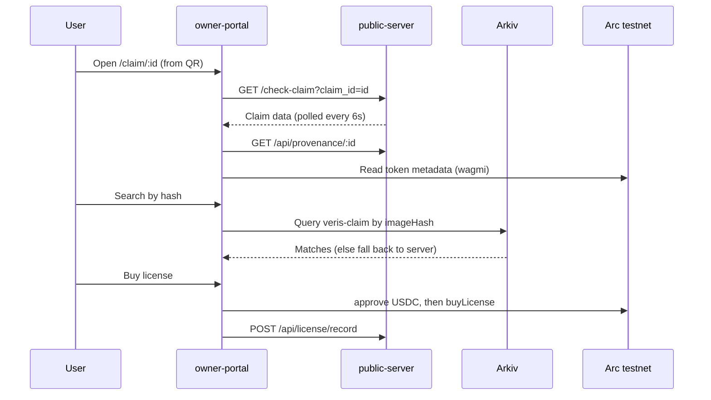

# Veris Owner Portal

The web app where people view, verify and license Veris photos.

## What it does

- Shows a landing page and waitlist form for Veris.
- Signs users in with Privy (wallet, email or SMS) and gives them an embedded wallet.
- Shows a claim page for each photo (`/claim/:claimId`) with status, provenance and similar photos.
- Lets anyone search by image file, SHA-256 hash or device ID.
- Looks up hashes on Arkiv straight from the browser, so the Veris server never sees the query.
- Runs an authenticity check that compares a candidate photo against a source of truth.
- Lets buyers license a photo for 5 USDC on Arc testnet.

> Note: the code in this folder talks to Sepolia and Arc testnet (EVM), not Solana. The wallet and chain code here is the EVM path.

## Where it fits



## Architecture / flow



## Folder structure

```
owner-portal/
├── src/
│   ├── main.jsx              # entry, loads fonts
│   ├── App.jsx               # providers (Privy, Wagmi, Query) and routes
│   ├── components/
│   │   ├── LandingPage/      # landing, story, waitlist form
│   │   ├── OwnerDashboard.jsx# sign-in and device/photo dashboard
│   │   ├── dashboard/        # data hooks, camera tab, photo cards
│   │   ├── ClaimPage.jsx     # one photo's claim and provenance
│   │   ├── SearchPage.jsx    # file, hash and device search
│   │   ├── AuthenticityCheckPage.jsx # two-photo compare
│   │   ├── LicenseButton.jsx # buy a license on Arc
│   │   ├── LicensesSection.jsx # license history from the explorer
│   │   └── ui/               # shadcn-style UI parts
│   └── lib/
│       ├── arkivDirect.js    # browser-side Arkiv lookup
│       ├── chains.js         # Sepolia and Arc labels and links
│       ├── arc.js            # Arc chain, license ABI, USDC address
│       └── contracts.js      # Veris contract ABI
├── api/claim-server/         # empty folder
├── public/esp32.html         # static page served as-is
├── vercel.json               # rewrites and SPA fallback
└── vite.config.js            # React, Tailwind, "@" alias, port 3000
```

## Tech stack

| Layer | Choice |
|-------|--------|
| Framework | React 18 + Vite 5 |
| Routing | react-router-dom 7 |
| Auth | Privy (`@privy-io/react-auth`) |
| Chain client | Wagmi 2 + Viem 2 |
| Arkiv | `@arkiv-network/sdk` |
| Data | axios + TanStack Query |
| Styling | Tailwind 4, shadcn-style UI, Radix |
| Hosting | Vercel (`vercel.json`) |

## Pages

| Route | Page | What it does |
|-------|------|--------------|
| `/` | LandingPage | Pitch, story, waitlist |
| `/dashboard` | OwnerDashboard | Privy sign-in, your photos and camera status |
| `/claim/:claimId` | ClaimPage | Claim status, provenance, similar photos, license button |
| `/search` | SearchPage | Search by image file, hash or device ID |
| `/authenticity-check` | AuthenticityCheckPage | Compare candidate photo with source of truth |
| `*` | redirect | Goes to `/` |

## Key code snippets

Routes live in one place.

```jsx
<Route path="/" element={<LandingPage />} />
<Route path="/dashboard" element={<OwnerDashboard />} />
<Route path="/claim/:claimId" element={<ClaimPage />} />
<Route path="/search" element={<SearchPage />} />
<Route path="/authenticity-check" element={<AuthenticityCheckPage />} />
```

The Arkiv lookup runs in the browser, no server needed.

```js
const res = await client.select({ $key: true, status: true, record: true })
  .from(Claims).where(eq(imageHash ? 'imageHash' : 'deviceId', imageHash || deviceId)).limit(20).fetch()
```

Hash search asks Arkiv first, then falls back to the server.

```js
let found = await searchArkiv(params).catch(() => [])
if (!found.length) found = (await axios.get(`${CLAIM_API}/api/arkiv/search`, { params, timeout: 10000 })).data?.results || []
```

Buying a license is one contract call on Arc.

```js
const hash = await writeContractAsync({ address: LICENSE_ADDRESS, abi: LICENSE_ABI, functionName: 'buyLicense', args: [BigInt(tokenId), photographer], chainId: arcTestnet.id })
```

## Backend calls the portal makes

| Call | To | Used by |
|------|----|---------|
| `GET /check-claim?claim_id=` | public-server | ClaimPage |
| `GET /api/provenance/:claimId` | public-server | ClaimPage |
| `GET /api/similar/:claimId?limit=4` | public-server | ClaimPage |
| `POST /api/search` (image file) | public-server | SearchPage |
| `GET /api/arkiv/search` | public-server | SearchPage fallback |
| `GET /claim/by-token/:tokenId` | public-server | Dashboard |
| `POST /api/license/record` | public-server | LicenseButton |
| `POST /api/waitlist` | public-server | Waitlist form |
| `GET /api/images/list`, `GET /api/device/status`, `POST /api/retry-pending` | hardware-web3-service | Dashboard |
| `POST /api/verify` | verify API | Authenticity check |

## Environment variables

Put them in `owner-portal/.env`. Vite only exposes `VITE_` names.

| Name | Purpose | Example |
|------|---------|---------|
| `VITE_PRIVY_APP_ID` | Privy app ID (sign-in is off without it) | `your-privy-app-id` |
| `VITE_CLAIM_SERVER_URL` | public-server base URL | `https://api.example.com` |
| `VITE_BACKEND_URL` | hardware-web3-service URL (default `http://localhost:5000`) | `http://localhost:5000` |
| `VITE_VERIFY_API_URL` | authenticity-check API (default `http://localhost:8000`) | `http://localhost:8000` |
| `VITE_IPFS_GATEWAY` | IPFS gateway for images (has a default) | `https://gateway.example.com/ipfs` |
| `VITE_PORTAL_URL` | public portal URL (default: current origin) | `http://localhost:3000` |
| `VITE_WAITLIST_URL` | waitlist endpoint (default: `VITE_CLAIM_SERVER_URL` + `/api/waitlist`) | `https://api.example.com/api/waitlist` |
| `VITE_LICENSE_ADDRESS` | license contract on Arc (has a default) | `0x...` |
| `VITE_ARC_USDC_ADDRESS` | USDC address on Arc (has a default) | `0x...` |

## Setup and run

```bash
cd owner-portal
npm install
cp .env.example .env     # then add VITE_PRIVY_APP_ID and VITE_CLAIM_SERVER_URL
npm run dev              # http://localhost:3000
```

```bash
npm run build            # output in dist/
npm run preview          # serve the build
```

## Testing

- There is no test script in `package.json`.
- Check by hand: run `npm run build`, then click through each route.
- TODO: add unit tests for `src/lib/arkivDirect.js` and `src/lib/chains.js`.

## Troubleshooting

- Sign-in button says to set `VITE_PRIVY_APP_ID`: add it to `.env` and restart `npm run dev`.
- Claim page says not found or offline: check `VITE_CLAIM_SERVER_URL` and that public-server is up.
- Dashboard shows nothing: `VITE_BACKEND_URL` must reach the Pi service or its tunnel.
- Authenticity check fails: start the verify API on `VITE_VERIFY_API_URL`.
- Hash search is empty: Arkiv's public endpoint is rate limited, retry in a bit.

## Tracks & sponsors used

| Sponsor | What we built | Files | Fallback or flag |
|---------|---------------|-------|------------------|
| Arkiv (Continuity track) | Browser-side hash and device lookup, no Veris server involved | `src/lib/arkivDirect.js`, `src/components/SearchPage.jsx` | Falls back to server `GET /api/arkiv/search` |
| Arc (testnet, USDC) | Buy a photo license for 5 USDC and list license history | `src/lib/arc.js`, `src/components/LicenseButton.jsx`, `src/components/LicensesSection.jsx` | `VITE_LICENSE_ADDRESS`, `VITE_ARC_USDC_ADDRESS` (defaults baked in) |
| Privy | Wallet, email and SMS sign-in with embedded wallets | `src/App.jsx`, `src/components/OwnerDashboard.jsx`, `src/components/ClaimPage.jsx` | Needs `VITE_PRIVY_APP_ID`, sign-in is off without it |
| Filecoin / Lighthouse | Photos load from Lighthouse IPFS gateways | `src/components/dashboard/helpers.js`, `src/components/ClaimPage.jsx` | `VITE_IPFS_GATEWAY` overrides the gateway |

- Arkiv lookup and Arc licensing are the event-era parts of this service (see the root README Arkiv section).
- Privy and Lighthouse image loading predate the event.
> TODO: 0G, Solana, vlayer and RISC Zero are not used in this service's code (only mentioned in `src/components/LandingPage/story/story.html` copy).

## Screenshots

<!-- TODO: screenshot of the landing page (save to docs/img/portal-landing.png) -->
> 📸 TODO: add screenshot of the landing page

<!-- TODO: screenshot of the dashboard after sign-in (save to docs/img/portal-dashboard.png) -->
> 📸 TODO: add screenshot of the dashboard after sign-in

<!-- TODO: screenshot of a claim page with provenance (save to docs/img/portal-claim.png) -->
> 📸 TODO: add screenshot of a claim page with provenance

<!-- TODO: screenshot of search by hash with results (save to docs/img/portal-search.png) -->
> 📸 TODO: add screenshot of search by hash with results

<!-- TODO: screenshot of the authenticity check result (save to docs/img/portal-authenticity.png) -->
> 📸 TODO: add screenshot of the authenticity check result

<!-- TODO: screenshot of the license purchase flow (save to docs/img/portal-license.png) -->
> 📸 TODO: add screenshot of the license purchase flow

## Related services

- [hardware-camera-app](../hardware-camera-app) - Raspberry Pi capture app
- [hardware-web3-service](../hardware-web3-service) - upload, proofs, minting
- [public-server](../public-server) - claim server and QR codes
- [contracts](../contracts) - smart contracts
