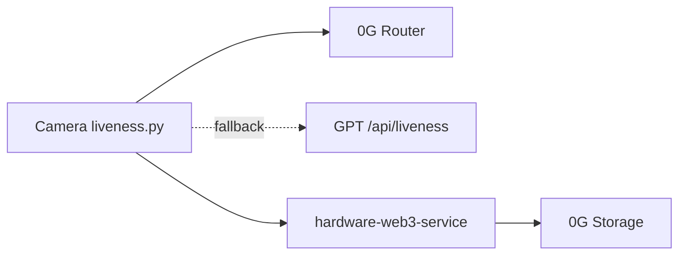

# 0G

- Prize and track: 0G (Router vision, TEE verification, 0G Storage).
- The ask:
  > TODO: paste the official 0G prize ask here
- Back to the [root README](../README.md).

## What we built

- The camera asks a 0G Router vision model if the photo is a real scene.
- The TEE flag and request id from the Router are kept with the verdict.
- Photos are stored on 0G Storage, with Lighthouse as fallback.
- Each capture gets a decision log stored on 0G.
- The claim page shows engine, request id, TEE and 0G refs.



## Before vs added

Before (repo started 2026-10-30):
- Camera signing and upload, Lighthouse storage, GPT vision in public-server.

Added (all dated 2026-11-06):
- `2b67190` camera liveness check, 0G first then GPT.
- `3ef170b` GPT liveness endpoint as fallback.
- `1ac28e9`, `8718698`, `c31560f` 0G Storage, bad-key safe, serial uploads.
- `91be18a` decision log per capture, stored on 0G.
- `c6f07cb` claim page shows verdict and 0G rows.

## Where in the code

| What | File:lines | Note |
|---|---|---|
| Router config | `hardware-camera-app/liveness.py:22-28` | Reads `ZEROG_*` env vars |
| Router vision call | `hardware-camera-app/liveness.py:84-105` | POSTs photos, parses verdict |
| Engine order | `hardware-camera-app/liveness.py:128-145` | 0G, then GPT, else `pending` |
| GPT fallback | `public-server/server.js:1669-1682` | `/api/liveness` |
| Decision log | `hardware-web3-service/decisionLog.js:28-41` | Uploads to 0G, else normal storage |
| 0G upload | `hardware-web3-service/zerogStorageService.js:38-54` | Serial queue, returns root hash |
| Provider order | `hardware-web3-service/storageService.js:21-38` | `STORAGE_PROVIDER` picks primary |
| Claim page rows | `owner-portal/src/components/ClaimPage.jsx:174-193` | Engine, request id, TEE |

## One snippet

`hardware-camera-app/liveness.py:94-96`

```python
body = {'model': ZEROG_MODEL, 'messages': [{'role': 'user', 'content': parts}]}
if ZEROG_VERIFY_TEE:
    body['verify_tee'] = True
```

## Verify in 3 steps

1. Run `grep -n "ZEROG" hardware-camera-app/liveness.py`.
2. Run `python3 hardware-camera-app/liveness.py <photo.jpg>` with `ZEROG_ENABLED=true`, `ZEROG_API_KEY`, `ZEROG_MODEL` set; expect `"engine": "0g"`.
3. Run `npm run dev` in `hardware-web3-service` with `STORAGE_PROVIDER=0g` and `ZEROG_PRIVATE_KEY`, open `http://localhost:5000/health`, expect `zerogStorage: true`.

## Honest gaps

- `tee_verified` is copied from the Router response; Veris does not check it itself.
- `ZEROG_ENABLED` and `ZEROG_VERIFY_TEE` default to false; the device key has low credit (402 falls back to GPT).
- The decision log is not signed; only the verdict is.
- No automated test for the 0G path.

> TODO: confirm 0G, TEE and `STORAGE_PROVIDER=0g` are on in the deployed env.
> TODO: add a live claim page URL that shows a `0g` capture.
> 📸 TODO: screenshot of the claim page with "Checked by 0G Compute", request id and TEE rows.
> 📸 TODO: screenshot of `liveness.py` terminal output with `engine: 0g`.
> 📸 TODO: screenshot of the 0G StorageScan page for a decision log root.
