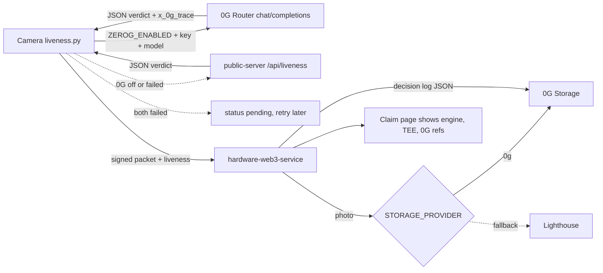

# 0G Prize Page

## Prize name

- 0G (Router vision, TEE verification, 0G Storage).

## One-line summary

- Veris asks a 0G Router vision model "is this photo a real scene?", keeps the TEE flag, and stores the photo and the decision log on 0G Storage.

## Before the event vs added at the event

- Repo started on 2026-10-30 (`779a2ff` initial). No 0G code existed then.
- Checked with `git log --format='%h %ad %s' --date=short -- <path>`.
- All 0G work below was committed on 2026-11-06.

| Part | Before | Added at the event |
|------|--------|--------------------|
| Camera signing and upload (`capture_pipeline.py`) | yes (2026-10-30) | liveness step added (`2b67190`) |
| GPT vision in public-server (`openaiService.js`) | yes (2026-10-28) | `/api/liveness` endpoint (`3ef170b`) |
| `liveness.py` (0G Router + GPT fallback) | no | `2b67190` |
| `zerogStorageService.js` | no | `1ac28e9`, `8718698`, `c31560f` |
| `storageService.js` (Lighthouse only) | yes (2026-10-30) | 0G primary or fallback (`1ac28e9`) |
| `decisionLog.js` | no | `91be18a`, `81532f9` |
| Claim page 0G rows | no | `c6f07cb` |
| Mobile proof panel says "0G Storage" | no | `da1732a` |

## Exact usage table

| What | File | Lines | What it does |
|------|------|-------|--------------|
| Router config and flags | `hardware-camera-app/liveness.py` | 22-28 | Reads `ZEROG_*` env vars; base URL defaults to `https://router-api.0g.ai/v1` |
| Router vision call | `hardware-camera-app/liveness.py` | 84-105 | POSTs both photos to `/chat/completions`, parses JSON verdict |
| TEE flag request | `hardware-camera-app/liveness.py` | 95-96 | Adds `verify_tee: true` to the body when `ZEROG_VERIFY_TEE=true` |
| TEE result and request id | `hardware-camera-app/liveness.py` | 102-105 | Reads `x_0g_trace` for `request_id` and `tee_verified` |
| Engine order and fallback | `hardware-camera-app/liveness.py` | 128-145 | 0G first, then GPT, else `pending` |
| GPT fallback call | `hardware-camera-app/liveness.py` | 108-115 | Calls public-server `/api/liveness` |
| GPT fallback endpoint | `public-server/server.js` | 1669-1682 | Runs `openaiService.assessLiveness`, returns `engine: 'gpt'` |
| Verdict signed into packet | `hardware-camera-app/capture_pipeline.py` | 457-466 | Runs liveness, signs with the verdict, stores result in `liveness` |
| Decision log record | `hardware-web3-service/decisionLog.js` | 7-25 | Builds JSON: verdict, engine, requestId, teeVerified, reasons |
| Decision log stored on 0G | `hardware-web3-service/decisionLog.js` | 28-41 | Uploads log to 0G, falls back to normal storage order |
| Decision log retry | `hardware-web3-service/decisionLog.js` | 43-45 | Retries logs not yet stored |
| Log built on upload | `hardware-web3-service/server.js` | 847-851 | Saves the log, stores it in the background |
| 0G Storage init | `hardware-web3-service/zerogStorageService.js` | 18-36 | Needs `ZEROG_PRIVATE_KEY`; bad key disables 0G only |
| 0G upload (serial queue) | `hardware-web3-service/zerogStorageService.js` | 38-54 | Merkle tree, `indexer.upload`, returns `0g` + root hash |
| 0G photo/metadata upload | `hardware-web3-service/zerogStorageService.js` | 56-67 | `uploadImage`, `uploadMetadata` |
| 0G download with proof | `hardware-web3-service/zerogStorageService.js` | 69-74 | `downloadToBlob(root, { proof: true })` |
| Ref format | `hardware-web3-service/zerogStorageService.js` | 5-11 | `0g` + 64 hex; `0g://` URI |
| Provider order | `hardware-web3-service/storageService.js` | 21-38 | `STORAGE_PROVIDER` picks primary; the other is fallback |
| Health flag | `hardware-web3-service/server.js` | 322 | `services.zerogStorage` in `/health` |
| Claim page rows | `owner-portal/src/components/ClaimPage.jsx` | 174-193 | Shows engine, 0G request id, TEE, decision log, photo on 0G |

## Code snippets

`hardware-camera-app/liveness.py:94-96`
```python
body = {'model': ZEROG_MODEL, 'messages': [{'role': 'user', 'content': parts}]}
if ZEROG_VERIFY_TEE:
    body['verify_tee'] = True
```

`hardware-camera-app/liveness.py:102-105`
```python
trace = data.get('x_0g_trace') or {}
parsed = _parse_json(data['choices'][0]['message']['content'])
return _result('0g', parsed, companion_jpeg,
               request_id=trace.get('request_id'), tee_verified=trace.get('tee_verified'))
```

`hardware-camera-app/liveness.py:128-131`
```python
engines = []
if ZEROG_ENABLED and ZEROG_API_KEY and ZEROG_MODEL:
    engines.append(('0g', _check_0g))
engines.append(('gpt', _check_gpt))
```

`hardware-web3-service/zerogStorageService.js:50-53`
```js
const [tx, err] = await this.indexer.upload(data, this.rpcUrl, this.signer);
if (err !== null) throw new Error(`0G upload: ${err}`);
if (!('rootHash' in tx)) throw new Error('0G upload was fragmented, not expected for a photo');
return refFromRoot(tx.rootHash);
```

`hardware-web3-service/decisionLog.js:33`
```js
const ref = await zerogStorageService.uploadMetadata(log).catch(() => storageService.uploadMetadata(log));
```

## Data flow



## Config flags and env vars (names only)

- Camera: `ZEROG_ENABLED`, `ZEROG_API_KEY`, `ZEROG_BASE_URL`, `ZEROG_MODEL`, `ZEROG_VERIFY_TEE`, `ZEROG_TIMEOUT`.
- Camera (GPT fallback): `PUBLIC_SERVER_URL`, `DEVICE_API_SECRET`, `GPT_LIVENESS_TIMEOUT`.
- Backend: `STORAGE_PROVIDER` (`lighthouse` default, `0g` makes 0G first).
- Backend: `ZEROG_PRIVATE_KEY`, `ZEROG_EVM_RPC`, `ZEROG_INDEXER_RPC`, `ZEROG_STORAGESCAN_URL`.
- Defaults in code: EVM RPC `https://evmrpc-testnet.0g.ai`, indexer `https://indexer-storage-testnet-turbo.0g.ai`.

## Fallback behavior

- 0G Router off, no key, no model, or any error (402, 429, 5xx, bad JSON): camera calls GPT.
- GPT also fails: status is `pending`, no verdict is guessed, capture is parked and retried.
- `check_liveness()` never raises, so it cannot block a capture.
- 0G Storage fails: photo goes to Lighthouse (and the reverse if Lighthouse is primary).
- Decision log: tries 0G first, then normal storage order; if both fail it is retried by `retryDecisionLogs`.
- Bad `ZEROG_PRIVATE_KEY` disables 0G only; backend still starts.
- Claim page shows 0G rows (request id, TEE, decision log) only when engine is `0g`.

## How a judge verifies in 3 steps

- 1. Read `hardware-camera-app/liveness.py` lines 84-145 and run `grep -n "ZEROG" hardware-camera-app/liveness.py`.
- 2. Run `python3 hardware-camera-app/liveness.py <photo.jpg>` with `ZEROG_ENABLED=true`, `ZEROG_API_KEY`, `ZEROG_MODEL` set; output shows `"engine": "0g"`, `request_id`, `tee_verified`.
- 3. Start `hardware-web3-service` (`npm run dev`), set `STORAGE_PROVIDER=0g` and `ZEROG_PRIVATE_KEY`, open `http://localhost:5000/health` and check `zerogStorage: true`; refs starting with `0g` are 0G roots.
- > TODO: add a live claim page URL that shows a `0g` capture.
- > 📸 TODO: screenshot of the claim page with "Checked by 0G Compute", request id and TEE rows.
- > 📸 TODO: screenshot of `liveness.py` terminal output with `engine: 0g`.
- > 📸 TODO: screenshot of the 0G StorageScan page for a decision log root.

## Commit hashes

- `2b67190` Camera: liveness check with 0G then GPT
- `3ef170b` GPT liveness endpoint (fallback)
- `1ac28e9` Store photos on 0G, Lighthouse fallback
- `8718698` Bad 0G key no longer stops startup
- `c31560f` Serial 0G uploads (nonce collisions)
- `91be18a` Decision log per capture, stored on 0G
- `81532f9` Verdict, storage links and mints published to claim record
- `c6f07cb` Claim page shows verdict, engine, 0G rows
- `da1732a` Mobile proof panel names 0G Storage
- All dated 2026-11-06.

## Gaps and honest limits

- Unknown: whether 0G, TEE or `STORAGE_PROVIDER=0g` is on in production. > TODO: confirm deployed env.
- `ZEROG_ENABLED`, `ZEROG_VERIFY_TEE` default to `false`; TEE is only asked for when set.
- `tee_verified` is copied from the Router response (`x_0g_trace`); Veris does not check it itself.
- The claim page shows "Not requested" for TEE when the flag is false or missing.
- The device holds a low-credit 0G key; a 402 sends the call to the GPT fallback.
- `ZEROG_MODEL` has no default; a vision model must be picked from the Router list.
- Storage uses the 0G testnet endpoints by default.
- The decision log is not part of the signature; only the verdict is signed.
- 0G Storage is not used by the camera app itself, only by the backend.
- > TODO: no automated test for the 0G path found in the repo.
