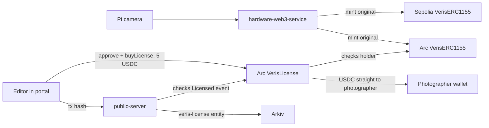

# Arc (Circle)

- Prize: Arc Studio Continuity Track, Bring Your Project to Arc ($3,000). Continuity participants only.
- Ask: take a project you already own and add a working Arc integration.
- Bounty we submit for: USDC payment flows added to an existing commerce product (editors pay USDC to license a photo). The payment is settled by a contract that checks the photographer holds the token.
- Back to the [root README](../README.md).

## What we built

- Every photo NFT is minted on Arc as well as Sepolia.
- An editor pays 5 USDC on Arc for a 30 day license.
- The USDC goes straight to the photographer.
- The portal has a license button and a license history list.
- The server mirrors each license to Arkiv, expiring with the term.

## Requirements checklist

| Requirement                                                          | Status                                                                                                               |
| -------------------------------------------------------------------- | -------------------------------------------------------------------------------------------------------------------- |
| Existing project, Arc part is new                                    | Yes, see Before vs added                                                                                             |
| Built in Arc Studio, shareable project URL, Studio shown in the demo |                                                                                                                      |
| Working frontend and backend                                         | Portal `LicenseButton` and `LicensesSection`, `public-server` record route, `hardware-web3-service` multi-chain mint |
| Architecture diagram                                                 | Below                                                                                                                |
| GitHub repo                                                          | https://github.com/Adityaadpandey/Veris (MIT)                                                                        |



## Before vs added

Before (last commits 2026-10-30):

- Single-chain mint in `hardware-web3-service/web3Service.js`.
- `DeviceRegistry` and `VerisERC1155` on Sepolia.

Added (all 2026-11-06):

- `d5cd1ac` license contract and Arkiv license record.
- `68598b8`, `274c6e1`, `da4ebce` Arc deploy setup, deployment record, redeploy.
- `9a22ed5`, `81532f9`, `ca593c0`, `1208337` multi-chain mint with retry.
- `26902e6`, `c190f52`, `27180a3` portal license button and history.
- `d01fdcb`, `4dff18c` mobile Arc constants and license history.

## Where in the code

| What               | File:lines                                           | Note                                  |
| ------------------ | ---------------------------------------------------- | ------------------------------------- |
| License contract   | `contracts/src/VerisLicense.sol:15-56`               | 5 USDC, 30 days, paid to photographer |
| License tests      | `contracts/test/VerisLicense.t.sol:39-61`            | 4 tests                               |
| Arc deployment     | `contracts/deployment-5042002.json:1`                | Chain id 5042002 and addresses        |
| Multi-chain mint   | `hardware-web3-service/chains.js:64-75`              | Primary first, others in background   |
| Retry failed mints | `hardware-web3-service/chains.js:48-60`              | Failed mint stays `pending`           |
| License button     | `owner-portal/src/components/LicenseButton.jsx:8-50` | Approve USDC, call `buyLicense`       |
| Record route       | `public-server/server.js:1770-1801`                  | Checks `Licensed` event, writes Arkiv |
| Arkiv entity       | `public-server/arkivService.js:102-112`              | `veris-license`, expires at term end  |

## One snippet

`contracts/src/VerisLicense.sol:41-51`

```solidity
function buyLicense(uint256 tokenId, address photographer) external returns (uint64 expiresAt) {
    require(photos.balanceOf(photographer, tokenId) > 0, "Payee does not hold the original");
    uint64 current = licenseEnds[tokenId][msg.sender];
    uint64 start = current > block.timestamp ? current : uint64(block.timestamp);
    expiresAt = start + TERM;
    licenseEnds[tokenId][msg.sender] = expiresAt;
    usdc.safeTransferFrom(msg.sender, photographer, PRICE);
    emit Licensed(tokenId, msg.sender, photographer, expiresAt);
}
```

## Verify in 3 steps

1. Run `cd contracts && forge test`. Result: 20 tests passed, 0 failed (6 suites).
2. Run `forge test --match-contract VerisLicenseTest`. Result: 4 passed, 0 failed.
3. Open `https://testnet.arcscan.app/address/0xA1B6ea0133da15dCFB5A5b4704022e4041f3Edb9` (Arc `VerisLicense`) and look for `Licensed` events.

## Honest gaps

- Tests use a fake USDC, not real Arc USDC.
- `VerisLicense` has its own deploy script, `contracts/script/DeployLicense.s.sol` (needs `VERIS_ADDRESS`; USDC defaults to the Arc testnet USDC). The live address was recorded by hand in `deployment-5042002.json`.
- Nothing blocks image download without a license; `isLicensed` is not called by any app.
- Same explorer: `testnet.arcscan.app` 301-redirects to `explorer.testnet.arc.io`. The history list calls its `/api/v2` logs endpoint, the links use the arcscan name.
- Real txs on Arc testnet (from the explorer logs API, 2026-11-07): `Licensed` event in `0x012434b543859cbd765d22a88bf4498a2f781601c9032809f4d39f4336bd9d5b`; `TransferSingle` on `VerisERC1155` in `0x98b193d9257c8cb755327eb5b54ba67110e5b42dd978bc7ab54642224555b9fe`.
