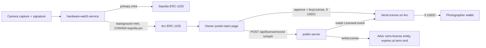

# Arc prize page

## Prize name

- Arc (Circle): USDC on Arc testnet.

## One-line summary

- Veris mints each photo NFT on Arc as well as Sepolia, and an editor pays 5 USDC on Arc for a 30 day license that the photographer receives directly.

## Before the event vs added at the event

- Dates come from `git log --format='%h %ad %s' --date=short`.
- Before the event (last commits dated 2026-10-30): the single-chain mint in `hardware-web3-service/web3Service.js` and `DeviceRegistry` / `VerisERC1155` on Sepolia.
- Added at the event (all dated 2026-11-06): everything below.
- `contracts/src/VerisLicense.sol`: `d5cd1ac` Add USDC photo licensing contract and Arkiv license records that expire with the term.
- `contracts/deployment-5042002.json`: `274c6e1` Record the Arc testnet deployment; `da4ebce` Redeploy with the new owner key under the Veris name on Sepolia and Arc.
- `contracts` Arc deploy setup: `68598b8` Make device registration owner-only and add Arc testnet to the deploy setup.
- `hardware-web3-service/chains.js`: `9a22ed5` Mint on every configured chain, retrying secondary chains in the background.
- `hardware-web3-service/chains.js`: `81532f9` per-chain mints in the claim record; `ca593c0` let Arc be the primary chain; `1208337` device balance on every chain.
- `owner-portal/src/lib/arc.js` and `LicenseButton.jsx`: `26902e6` Portal: USDC license button on Arc.
- `owner-portal/src/lib/arc.js`: `c190f52` default to the live Arc deployment.
- `owner-portal/src/components/LicensesSection.jsx`: `27180a3` Licenses section read from Arc's indexer.
- `public-server/server.js` route `/api/license/record`: added in `d5cd1ac`.
- `mobile-app/src/constants/config.ts`: `d01fdcb`; `mobile-app/src/components/licenses-card.tsx`: `4dff18c`.
- Env examples: `1c63906` Add the Arc license contract address to the env examples.

## Exact usage table

| What | File | Lines | What it does |
|---|---|---|---|
| License contract | `contracts/src/VerisLicense.sol` | 15-56 | 5 USDC, 30 day license, paid straight to the photographer |
| `buyLicense` | `contracts/src/VerisLicense.sol` | 41-51 | Checks payee holds the token, extends the term, pulls USDC, emits `Licensed` |
| `isLicensed` | `contracts/src/VerisLicense.sol` | 53-55 | Returns true while the license end time is in the future |
| License tests | `contracts/test/VerisLicense.t.sol` | 39-61 | Four tests: pay, expiry, wrong payee, stacking |
| Arc deployment record | `contracts/deployment-5042002.json` | 1 | Chain id and three Arc addresses |
| Arc deploy RPC / explorer | `contracts/foundry.toml` | 22-26 | Arc RPC alias and ArcScan verify config |
| Chain table (sepolia, base-sepolia, arc) | `hardware-web3-service/chains.js` | 10-14 | Chain id, RPC env name, default RPC and explorer per chain |
| `CHAINS` flag read | `hardware-web3-service/chains.js` | 24-38 | Builds a secondary service per extra chain |
| Multi-chain mint loop | `hardware-web3-service/chains.js` | 64-75 | Primary mint first, then a background mint on each other chain |
| Retry of failed Arc mints | `hardware-web3-service/chains.js` | 48-60, 77-79 | Failed mint stays `pending` and is retried |
| Retry timer | `hardware-web3-service/server.js` | 1360-1362 | Interval calls `retrySecondaryMints` |
| Mint calls | `hardware-web3-service/server.js` | 925, 1187, 1316 | Capture paths call `mintEverywhere` |
| Chain tests | `hardware-web3-service/chains.test.js` | 13-30 | Pending, minted rows and the Arc explorer link |
| Arc chain, USDC, license addresses | `owner-portal/src/lib/arc.js` | 4-26 | Chain definition, addresses, 5 USDC price, ABIs |
| License button | `owner-portal/src/components/LicenseButton.jsx` | 8-50 | Switch to Arc, approve USDC, call `buyLicense`, post tx hash to server |
| License history (web) | `owner-portal/src/components/LicensesSection.jsx` | 13-44 | Reads `Licensed` events from the Arc explorer indexer |
| Button and history mounted | `owner-portal/src/components/ClaimPage.jsx` | 675, 693 | Shows both on the claim page |
| Record route | `public-server/server.js` | 1770-1801 | Confirms `Licensed` event on Arc, then writes to Arkiv |
| Arkiv license entity | `public-server/arkivService.js` | 102-112 | Creates `veris-license` that expires when the term ends |
| Mobile Arc constants | `mobile-app/src/constants/config.ts` | 77-89 | Arc explorer, license address, topic, chain names |
| Mobile license history | `mobile-app/src/components/licenses-card.tsx` | 24-114 | Lists licensees and shows USDC earned |

## Code snippets

- License purchase, `contracts/src/VerisLicense.sol:41-51`:

```solidity
function buyLicense(uint256 tokenId, address photographer) external returns (uint64 expiresAt) {
    require(photos.balanceOf(photographer, tokenId) > 0, "Payee does not hold the original");

    uint64 current = licenseEnds[tokenId][msg.sender];
    uint64 start = current > block.timestamp ? current : uint64(block.timestamp);
    expiresAt = start + TERM;
    licenseEnds[tokenId][msg.sender] = expiresAt;

    usdc.safeTransferFrom(msg.sender, photographer, PRICE);
    emit Licensed(tokenId, msg.sender, photographer, expiresAt);
}
```

- Multi-chain mint loop, `hardware-web3-service/chains.js:64-75`:

```js
const primary = await web3Service.mintOriginal(payload);
for (const chain of secondaries.keys()) {
  dbService.saveChainMint(image.id, chain, { status: 'pending', payload: JSON.stringify(payload) });
  mintSecondary({ image_id: image.id, chain, payload: JSON.stringify(payload) });
}
return primary;
```

- Portal buy step, `owner-portal/src/components/LicenseButton.jsx:31-35`:

```js
const hash = await writeContractAsync({ address: LICENSE_ADDRESS, abi: LICENSE_ABI, functionName: 'buyLicense', args: [BigInt(tokenId), photographer], chainId: arcTestnet.id })
await arcClient.waitForTransactionReceipt({ hash })
axios.post(`${claimApi}/api/license/record`, { txHash: hash }).catch(() => {})
```

## Deployed contracts and chain id

- Chain: Arc testnet, chain id `5042002` (`contracts/deployment-5042002.json`).
- Arc `DeviceRegistry`: `0x7e6bd8193E9762430ff6E494764D74036E333c14`
- Arc `VerisERC1155`: `0xB7909d4bba142AfF48aF7509B070e64eC1c6AdAc`
- Arc `VerisLicense`: `0xA1B6ea0133da15dCFB5A5b4704022e4041f3Edb9`
- Arc USDC (ERC-20 interface): `0x3600000000000000000000000000000000000000` (`owner-portal/src/lib/arc.js:16`).
- Sepolia (chain id `11155111`) uses the same `DeviceRegistry` address; its `VerisERC1155` is `0xA1B6ea0133da15dCFB5A5b4704022e4041f3Edb9` (`contracts/deployment-11155111.json`).
- The Sepolia `VerisERC1155` and the Arc `VerisLicense` share one address, so check the chain before reading either.

## Data flow



## Config flags and env vars

- `CHAINS` (hardware-web3-service): chains to mint on, e.g. `sepolia,arc`.
- `ARC_RPC_URL` (hardware-web3-service, public-server): Arc RPC override.
- `LICENSE_CONTRACT_ADDRESS` (public-server): license contract to check.
- `VITE_LICENSE_ADDRESS` (owner-portal): license address override.
- `VITE_ARC_USDC_ADDRESS` (owner-portal): Arc USDC address override.
- `ARKIV_ENABLED`: turns the Arkiv license write on (named in `docs/DECISIONS.md`).
- `ARCSCAN_API_KEY` (contracts): used by the Foundry verify config.

## Fallback behavior

- An Arc mint failure never fails the Sepolia mint (`chains.js:62-63`).
- A failed Arc mint is saved as `pending` and retried by a timer (`chains.js:57`, `server.js:1360`).
- If Arc is down at boot, that chain stays unconfigured and its mints stay `pending` (`chains.js:50`).
- Arkiv write failure only logs a warning; the license is still final on-chain (`server.js` route, `LicenseButton.jsx:34`).
- License history on web and mobile shows an empty list with a "couldn't reach" note if the explorer indexer fails.
- Default `CHAINS` is `sepolia` only, so nothing changes without the flag.

## How a judge verifies in 3 steps

- 1. Open the Arc `VerisLicense` address on `https://testnet.arcscan.app` (base URL from `hardware-web3-service/chains.js:13`) and look for `Licensed` events.
- 2. Open a claim page in the owner portal, click "License this photo · 5 USDC", and confirm the USDC transfer to the photographer on ArcScan.
- 3. Run `cd contracts && forge test --match-contract VerisLicenseTest` and see 4 passed.
- Address link format: `https://testnet.arcscan.app/address/<address>`.
- > TODO: paste one real `buyLicense` tx hash and its ArcScan link here.
- > TODO: paste one real Arc mint tx hash for a captured photo.

## forge test result

- Command: `cd contracts && forge test` (run on this repo).
- Whole suite: `Ran 6 test suites ... 20 tests passed, 0 failed, 0 skipped (20 total tests)`.
- License suite (`forge test --match-contract VerisLicenseTest`): `4 tests passed, 0 failed, 0 skipped`.
- `test_editorPaysPhotographerFiveUsdc` PASS
- `test_licenseEndsAfterTerm` PASS
- `test_cannotPayAWalletThatDoesNotHoldTheOriginal` PASS
- `test_buyingAgainStacksTheTerm` PASS
- The tests use a fake USDC token, not real Arc USDC.

## Commit hashes

- `d5cd1ac` license contract, Arkiv license record, record route.
- `68598b8` Arc added to deploy setup.
- `274c6e1` Arc deployment recorded.
- `da4ebce` redeploy under new owner key.
- `9a22ed5` multi-chain mint with retry.
- `81532f9` per-chain mints in the claim record.
- `ca593c0` Arc can be the primary chain.
- `1208337` balance on every chain.
- `26902e6` portal license button.
- `c190f52` default to live Arc deployment.
- `27180a3` portal Licenses section.
- `d01fdcb` mobile Arc constants.
- `4dff18c` mobile license history.
- `1c63906` env examples.

## Gaps and honest limits

- No deploy script for `VerisLicense`; `contracts/script/Deploy.s.sol` has no license code. > TODO: add one or document how Arc was deployed.
- Arc is testnet only.
- The license is only checked on-chain; there is no gate that blocks image download without a license.
- `isLicensed` is not called by the portal, mobile app or server; history comes from `Licensed` events.
- The Arkiv entity is a readable mirror; the contract is the source of truth.
- Mobile app is read-only for licenses; buying happens in the web portal.
- Mobile and web history use `https://explorer.testnet.arc.io/api/v2`, while mint links use `https://testnet.arcscan.app`. > TODO: confirm both hosts are the same explorer.
- Tests use a fake USDC; the real Arc USDC call path was not covered by `forge test`.
- The record route trusts the tx hash from the client but re-reads the event from chain, so it cannot be forged by hash alone.

## Screenshots

> 📸 TODO: claim page with the "License this photo · 5 USDC" button.
> 📸 TODO: wallet approval for the USDC transfer on Arc.
> 📸 TODO: ArcScan page of the `buyLicense` transaction.
> 📸 TODO: Licenses section listing the new license.
> 📸 TODO: Arkiv `veris-license` entity.
> 📸 TODO: mobile licenses card showing USDC earned.
