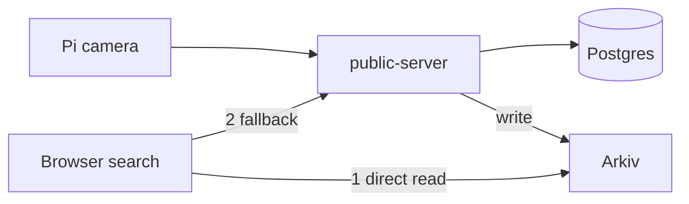

# Arkiv

- Prize and track: Arkiv, ETHGlobal Mumbai, Continuity track.
- The ask: Build on Arkiv (existing projects).
- Back to the [root README](../README.md#arkiv-ethglobal-mumbai-continuity-track).

## What we built

- Every photo claim is mirrored to Arkiv as a `veris-claim` entity.
- Each USDC license is written as a `veris-license` entity that expires with the term.
- `GET /api/arkiv/search` finds a photo by hash or device id, Arkiv first, Postgres second.
- The browser hashes a photo on the device and asks Arkiv directly, no key needed.
- Failed writes are retried every 60 s; a capture never fails because Arkiv is down.



## Before vs added

Before (first Arkiv commit is `65f02bf`):
- Pi camera app, hardware signing, Filecoin/Lighthouse storage.
- Postgres claim server, ERC-1155 contracts, owner portal, mobile app.
- Claim and search pages that read Postgres only.

Added (all dated 2026-11-06):
- `65f02bf` claims mirrored to Arkiv, Postgres fallback.
- `d5cd1ac` license entity that expires with the term.
- `bb8a02d` verify page searches by hash or device id.
- `6f2a93f`, `8686889` browser-side Arkiv lookup; Search page asks Arkiv first.

## Where in the code

| What | File:lines | Note |
|---|---|---|
| Enable check | `public-server/arkivService.js:16` | On only with `ARKIV_ENABLED=true` and a key |
| Claim schema | `public-server/arkivService.js:28-35` | Indexed claim fields |
| Write claim | `public-server/arkivService.js:68-82` | Patch or create, with expiry |
| License write | `public-server/arkivService.js:101-112` | Expires at the license end |
| Retry sweep | `public-server/server.js:1711-1718` | Every 60 s for unsynced rows |
| Search route | `public-server/server.js:1749-1768` | Arkiv, then Postgres |
| Browser search | `owner-portal/src/lib/arkivDirect.js:31-52` | Keyless read, 8 s deadline |
| Search page | `owner-portal/src/components/SearchPage.jsx:290-292` | Arkiv first, server second |

## One snippet

`public-server/arkivService.js:77-80`

```js
const expiration = f.status === 'minted'
  ? ExpirationTime.fromDays(Math.min(Number(process.env.ARKIV_CLAIM_DAYS || 180), 180))
  : ExpirationTime.fromHours(24);
const { entityKey } = await walletClient.createEntity(Claims, f, { expiration });
```

## Verify in 3 steps

1. Run `curl "https://api.veris.live/api/arkiv/search?imageHash=940d4b013da66f9d767e04e0fe516222c6193b3c4b476bdf022e8fd24e7986f3"`.
2. Expect `"source":"arkiv"` and two minted claims (Arc tokens 12 and 13).
3. Check the writer wallet on Arkiv testnet (chain id 7794095): `0xC15aF2A372D01B5223819bB328400DB8b14d1894` (14 minted, 0 pending on 2026-11-06).

Runnable query (key from https://hub.arkiv.network/access-keys, `Claims` is the schema in [arkiv/schema.md](../arkiv/schema.md)):

```js
const client = createPublicClient({ chain: rabdi({ accessKey: process.env.ARKIV_ACCESS_KEY }), transport: http() })
const r = await client.select({ $key: true, status: true }).from(Claims).where(eq('status', 'minted')).limit(5).fetch()
```

Example entity: `0x309b48e503a9447378b6f2285296f9c44b8ea3a4bd72957645e083b8a7f3b958`.

## Honest gaps

- Postgres is the permanent record; minted entities last at most about 180 days.
- Only `claimId`, `imageHash`, `deviceId` are queried; other indexed fields are unused.
- The browser check is exact-hash only; altered copies still go to the server.
- The `record` field is plain JSON, not encrypted.

> TODO: confirm `ARKIV_ENABLED=true` is still set on the live server at judging time.
> 📸 TODO: screenshot of the curl output showing `"source":"arkiv"`.
> 📸 TODO: screenshot of the portal Search page with a hash result.
> 📸 TODO: screenshot of the writer wallet's entities on the Arkiv explorer.
