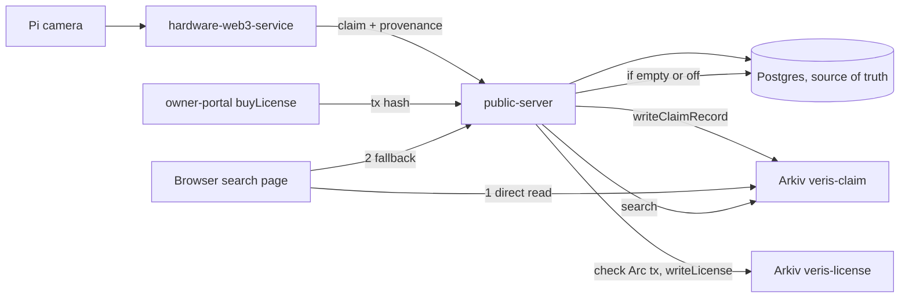

# Arkiv prize page

## Prize and track

- Prize: Arkiv, "Build on Arkiv (existing projects)".
- Event and track: ETHGlobal Mumbai, Continuity track.
- Back to the [root README](../README.md#arkiv-ethglobal-mumbai-continuity-track).

## One line

- Veris mirrors every photo's provenance record to Arkiv, so anyone can check a photo without trusting our server.

## Before the event vs added at the event

Before (no Arkiv code anywhere; the first Arkiv commit is `65f02bf`):
- Pi camera app, hardware signing, Filecoin/Lighthouse storage.
- Postgres claim server (`public-server`), ERC-1155 contracts, owner portal, mobile app.
- Claim and search pages that read Postgres only (Postgres swap `0e61572`, 2026-10-28).

Added at the event (all dated 2026-11-06 in git):
- `65f02bf` claim records mirrored to Arkiv, Postgres fallback (`public-server/arkivService.js`).
- `d5cd1ac` `veris-license` entity that expires with the term.
- `3811d5d` owner wrapped in `addr()`; `9654859` hex record decode; `964c451` log why a search fell back.
- `bb8a02d` verify page searches by hash or device id.
- `6f2a93f` browser-side Arkiv lookup (`arkivDirect.js`); `8686889` SearchPage asks Arkiv first.
- `d4bcbc8`, `4540acf`, `c283bf2`, `4d6a910` docs under `arkiv/` and README.
- > TODO: the git dates do not show the event start time. Confirm that the 2026-11-06 commits are all inside the event window.

## Exact usage

| What | File:lines | What it does |
|---|---|---|
| Enable check | `public-server/arkivService.js:16` | On only if `ARKIV_ENABLED=true` and a private key is set |
| `veris-claim` schema | `public-server/arkivService.js:28-35` | Defines the indexed claim fields |
| Clients | `public-server/arkivService.js:37-43` | Public and wallet client on the `rabdi` chain |
| Write claim | `public-server/arkivService.js:68-82` | Patch in place, or create new entity with expiry |
| Expiry choice | `public-server/arkivService.js:77-79` | `minted` up to 180 days, `pending` 24 hours |
| Query by filter | `public-server/arkivService.js:84-88` | `select().from(Claims).where().limit(20)` |
| Get one claim | `public-server/arkivService.js:90-94` | By `claimId`, prefers the `minted` row |
| Search | `public-server/arkivService.js:96-99` | By `imageHash` or `deviceId` |
| `veris-license` write | `public-server/arkivService.js:101-112` | Entity expires at the license end time |
| Sync after provenance | `public-server/server.js:1699-1709` | Writes to Arkiv, marks the row synced |
| Retry sweep | `public-server/server.js:1711-1718` | Every 60 s, retries unsynced rows |
| Provenance POST | `public-server/server.js:1726-1732` | Saves to Postgres, then `syncToArkiv` |
| Provenance GET | `public-server/server.js:1734-1747` | Arkiv first, Postgres fallback |
| Search route | `public-server/server.js:1749-1768` | `GET /api/arkiv/search`, Arkiv then Postgres |
| License record route | `public-server/server.js:1770-1795` | Checks the Arc tx, then writes the license entity |
| Sync columns | `public-server/dbService.js:62-64`, `496-521` | `arkiv_key`, `arkiv_status`, `arkiv_synced` and helpers |
| Browser claim schema | `owner-portal/src/lib/arkivDirect.js:11-18` | Same shape, read only |
| Browser search | `owner-portal/src/lib/arkivDirect.js:31-52` | Keyless read with retries and an 8 s deadline |
| Hash in browser | `owner-portal/src/lib/arkivDirect.js:56-60` | SHA-256 of the file on the device |
| Exact-match verdict | `owner-portal/src/lib/arkivDirect.js:65-77` | Photo never leaves the browser |
| Search page use | `owner-portal/src/components/SearchPage.jsx:156`, `290-292` | Arkiv first, server second |

## Code snippets

Schema, `public-server/arkivService.js:28-35`:

```js
const Claims = defineSchema('veris-claim', {
  claimId: str().indexed(),
  imageHash: str().indexed(),
  deviceId: str().indexed().optional(),
  owner: addr().indexed().optional(),
  status: str().indexed(),
  record: bytes(), // the full provenance JSON
});
```

Expiry, `public-server/arkivService.js:77-80`:

```js
const expiration = f.status === 'minted'
  ? ExpirationTime.fromDays(Math.min(Number(process.env.ARKIV_CLAIM_DAYS || 180), 180))
  : ExpirationTime.fromHours(24);
const { entityKey } = await walletClient.createEntity(Claims, f, { expiration });
```

License expires with its term, `public-server/arkivService.js:108-110`:

```js
const { entityKey } = await walletClient.createEntity(Licenses, {
  tokenId: String(l.tokenId), licensee: l.licensee.toLowerCase(), chain: l.chain, txHash: l.txHash, record: toBytes(l),
}, { expiration: ExpirationTime.atDate(new Date(l.expiresAt * 1000)) });
```

Query, `public-server/arkivService.js:86`:

```js
const result = await publicClient.select({ $key: true, record: true, status: true }).from(Claims).where(filter).limit(20).fetch();
```

Browser asks Arkiv first, `owner-portal/src/components/SearchPage.jsx:290-292`:

```js
// Ask Arkiv directly first, so Veris never sees the lookup. Our server is only the fallback.
let found = await searchArkiv(params).catch(() => [])
if (!found.length) found = (await axios.get(`${CLAIM_API}/api/arkiv/search`, { params, timeout: 10000 })).data?.results || []
```

## Entity schema

`veris-claim` (one per captured photo):
- Indexed: `claimId`, `imageHash`, `deviceId` (optional), `owner` (optional addr), `status` (`pending` or `minted`).
- Not indexed: `record` (bytes, full provenance JSON).
- Life: `pending` 24 hours; `minted` `ARKIV_CLAIM_DAYS`, max 180 days.

`veris-license` (one per USDC license on Arc):
- Indexed: `tokenId`, `licensee` (lower-cased).
- Not indexed: `chain`, `txHash`, `record`.
- Life: exactly until the license `expiresAt`.

- Only the backend writer wallet writes. Users only read.
- Full tables: [arkiv/schema.md](../arkiv/schema.md).

## Data flow



## Config flags and env vars

Backend, from `public-server/.env.example:91-95`:
- `ARKIV_ENABLED` - `true` turns the mirror on. Default off.
- `ARKIV_PRIVATE_KEY` - writer wallet key, funded with testnet tGLM.
- `ARKIV_ACCESS_KEY` - from hub.arkiv.network/access-keys.
- `ARKIV_CLAIM_DAYS` - minted life, default 180, capped at 180.

Other:
- `LICENSE_CONTRACT_ADDRESS`, `ARC_RPC_URL` - used by `/api/license/record` (`server.js:1774`, `1779`).
- Browser lookup uses no key (`rabdi({ accessKey: '' })`, `arkivDirect.js:33`).
- SDK: `@arkiv-network/sdk ^1.0.1` in `public-server/package.json:23` and `owner-portal/package.json:12`.

## Fallback behavior

- Flag off or key missing: nothing is written, all reads use Postgres (`arkivService.js:16`).
- Failed write: row stays `arkiv_synced = false`, retried every 60 s (`server.js:1711-1718`).
- Arkiv search error or no result: server falls back to Postgres (`server.js:1750-1768`).
- Provenance read: Arkiv first, then Postgres (`server.js:1737-1743`).
- Browser: 3 retries, 8 s deadline, then calls our server (`arkivDirect.js:28`, `SearchPage.jsx:292`).
- A capture never fails because Arkiv is down.

## Judge check in 3 steps

1. Run the live verify call:
   ```bash
   curl "https://api.veris.live/api/arkiv/search?imageHash=940d4b013da66f9d767e04e0fe516222c6193b3c4b476bdf022e8fd24e7986f3"
   ```
2. Expect `"source":"arkiv"` and two `minted` claims (Arc tokens 12 and 13), per the root README.
3. Check the writer wallet on Arkiv testnet (chain id 7794095): `0xC15aF2A372D01B5223819bB328400DB8b14d1894`. Live count on 2026-11-06 was 14 `minted`, 0 `pending`.

- Optional: run the query from the root README with a key from https://hub.arkiv.network/access-keys.
- Example entity: `0x309b48e503a9447378b6f2285296f9c44b8ea3a4bd72957645e083b8a7f3b958`.

> 📸 TODO: screenshot of the curl output showing `"source":"arkiv"`.
> 📸 TODO: screenshot of the portal Search page with a hash result.
> 📸 TODO: screenshot of the writer wallet's entities on the Arkiv explorer.

## Commits

- `65f02bf` Arkiv mirror in public-server
- `d5cd1ac` license entity that expires with the term
- `3811d5d` addr() fix for owner
- `9654859` hex decode of the record
- `964c451` log search fallback reason
- `bb8a02d` verify page: search by hash or device id
- `6f2a93f` browser-side Arkiv lookup
- `8686889` SearchPage asks Arkiv first
- `d4bcbc8`, `4540acf`, `c283bf2`, `4d6a910` docs

## Gaps and honest limits

- Postgres is the permanent record; Arkiv minted entities last at most about 180 days.
- Code only queries `claimId`, `imageHash`, `deviceId`; `owner`, `status`, `tokenId`, `licensee` are indexed but no query uses them yet.
- No endpoint or page lists licenses from Arkiv, despite wording in `arkiv/reach.md`.
- `arkivDirect.js:30` mentions `anonRpc.js`, which is not in `owner-portal/src/lib`; the `fetchFn` hook is unused here.
- The browser check is exact-hash only; altered copies still need the server's perceptual check.
- The `record` field is plain JSON, not encrypted.
- Real usage numbers are still open. > TODO: fill `arkiv/reach.md` with real user numbers.
- > TODO: confirm `ARKIV_ENABLED=true` is still set on the live server at judging time.
