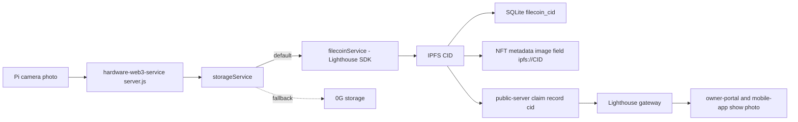

# Prize: Filecoin / Lighthouse (storage)

## One-line summary
- Every photo and its metadata JSON is uploaded to IPFS through the Lighthouse SDK, and the CID is saved with the NFT claim.

## Honest scope (read first)
- We use the Lighthouse SDK (`@lighthouse-web3/sdk`). Lighthouse pins to IPFS and Filecoin.
- We do NOT use Synapse. `@filoz/synapse-sdk` is in `hardware-web3-service/package.json` line 24 but is never imported.
- We do NOT run our own Filecoin deals or read deal status.
- UI text "Filecoin · Lighthouse" is a label only (`owner-portal/src/components/ClaimPage.jsx:667`).

## Before the event vs added at the event
> TODO: confirm the exact event start date. Below, "added 2026-11-06" is the build-day commit date.
- Before: Lighthouse upload service. Commit `c943963` (2026-10-28), `f0d5491` (2026-10-28).
- Before: portal and mobile read photos from Lighthouse gateways. `c8d147a` (2026-10-30).
- Before: Filebase-first experiment, then reverted. `6fc0803` then `bfc1979` (2026-10-29).
- Added 2026-11-06: `storageService.js` wraps Lighthouse and 0G with fallback. Commit `1ac28e9`.
- Added 2026-11-06: startup no longer stops if 0G is broken, Lighthouse still works. Commit `8718698`.
- Added 2026-11-06: public-server `/api/image/:cid` serves Lighthouse CIDs and 0G refs. Commit `1ac28e9`.

## Exact usage
| What | File | Lines | What it does |
|---|---|---|---|
| Lighthouse client import | `hardware-web3-service/filecoinService.js` | 1 | imports `@lighthouse-web3/sdk` |
| Init with API key | `hardware-web3-service/filecoinService.js` | 13-24 | reads `LIGHTHOUSE_API_KEY`, disables upload if missing |
| Image upload, 3 retries | `hardware-web3-service/filecoinService.js` | 26-69 | writes temp file, `lighthouse.upload`, returns CID, deletes temp file |
| Metadata upload | `hardware-web3-service/filecoinService.js` | 72-89 | `lighthouse.uploadText` of `metadata.json`, returns CID |
| Provider order + fallback | `hardware-web3-service/storageService.js` | 4-38 | `STORAGE_PROVIDER` picks first store, tries the other on failure |
| Upload on capture | `hardware-web3-service/server.js` | 864-886 | uploads image then metadata, saves both CIDs |
| Save CIDs in DB | `hardware-web3-service/dbService.js` | 70-71, 88 | columns `filecoin_cid`, `filecoin_metadata_cid` |
| Retry failed uploads | `hardware-web3-service/server.js` | 1264-1287 | phase 1 of retry re-uploads saved images |
| Gateway proxy | `public-server/server.js` | 1801-1815 | `/api/image/:cid` streams from `LIGHTHOUSE_GATEWAY` |
| Gateway list (portal) | `owner-portal/src/components/dashboard/helpers.js` | 38-49 | tries gateways in order on image error |
| Gateway list (claim page) | `owner-portal/src/components/ClaimPage.jsx` | 32-44 | same fallback idea |
| Gateway list (mobile) | `mobile-app/src/constants/config.ts` | 42-55 | own server first, then 4 Lighthouse gateways |

## Real code
`hardware-web3-service/filecoinService.js:45-49`
```js
const response = await lighthouse.upload(tmpPath, this.apiKey);
const cid = response?.data?.Hash;
if (!cid) {
  throw new Error('Upload succeeded but no CID returned');
}
```
`hardware-web3-service/storageService.js:21-25`
```js
_order() {
  const primary = process.env.STORAGE_PROVIDER === '0g' ? '0g' : 'lighthouse';
  const other = primary === '0g' ? 'lighthouse' : '0g';
  return [primary, other].filter((name) => providers[name].initialized);
}
```
`hardware-web3-service/server.js:864-866`
```js
if (storageService.initialized) {
  console.log(`   🔄 Uploading to Filecoin...`);
  filecoinCid = await storageService.uploadImage(filepath);
```

## Data flow


## Config flags and env vars (names only)
- `LIGHTHOUSE_API_KEY` (hardware-web3-service)
- `STORAGE_PROVIDER` (`lighthouse` default, `0g` flips order)
- `LIGHTHOUSE_GATEWAY` (public-server)
- `VITE_IPFS_GATEWAY` (owner-portal)

## Fallback behavior
- No `LIGHTHOUSE_API_KEY`: Lighthouse is skipped, warning logged (`filecoinService.js:15-19`).
- Upload fails: retried 3 times with 1s, 2s delay (`filecoinService.js:55-58`).
- Lighthouse fails: `storageService` tries 0G (`storageService.js:27-38`).
- Upload fails in server: image stays saved locally, status `saved`, retry endpoint can redo it (`server.js:977-994`, `1264`).
- Gateway fails in browser: next gateway is tried (`helpers.js:47-49`).

## How a judge verifies in 3 steps
1. Open `hardware-web3-service/filecoinService.js`, see `lighthouse.upload` at line 45.
2. Run the web3 service with `LIGHTHOUSE_API_KEY` set, send a photo, read the log line `Lighthouse upload CID`.
3. Open the CID at a `lighthouseweb3.xyz/ipfs/<cid>` gateway (see `LIGHTHOUSE_GATEWAY`) or on the claim page.
> 📸 TODO: screenshot of the server log showing the Lighthouse CID.
> 📸 TODO: screenshot of the claim page showing "Filecoin · Lighthouse" and the photo.

## Commit hashes
- `c943963`, `f0d5491` Lighthouse service (2026-10-28)
- `6fc0803`, `bfc1979` Filebase tried and reverted (2026-10-29)
- `c8d147a` shared gateway list in mobile (2026-10-30)
- `1ac28e9` storageService with 0G + Lighthouse fallback (2026-11-06)
- `8718698` startup keeps Lighthouse working if 0G fails (2026-11-06)

## Gaps and honest limits
- No Synapse code. Do not claim it.
- No Filecoin deal ID or proof-of-storage is read or shown.
- Gateways are tied to the API key, old photos need old subdomains (`config.ts:42-46` comment).
- `server.js:96` initializes `filecoinService` directly; `storageService.initialize` call site not checked. > TODO: confirm `storageService.initialize` is called at startup.
- Landing page copy says "Filecoin via Synapse SDK" (`owner-portal/src/components/LandingPage/story/story.html:1461`). This is wrong vs the code. > TODO: fix the copy before judging.
- Camera app message mentions USDFC balance (`hardware-camera-app/raspberry_pi_camera_app.py:993`), a leftover from Synapse. Not used by Lighthouse.
