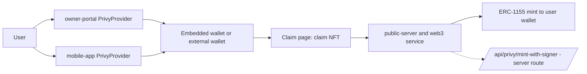

# Prize: Privy

## One-line summary
- Privy is the login and embedded wallet for both the web portal and the mobile app, plus a server-side session-signer mint route.

## Before the event vs added at the event
> TODO: confirm the exact event start date. "2026-11-06" is the build-day commit date.
- Before: server Privy service and routes. Commit `c943963` (2026-10-28).
- Before: portal `PrivyProvider`. Commits `c943963`, `0e12df1` (2026-10-28/29).
- Before: mobile app Privy login. Commit `939ba51` (2026-10-28).
- Added 2026-11-06: only edits that touch `App.jsx` (`26902e6`, Arc license button) and the claim page. No new Privy feature found. > TODO: confirm with the team.

## Exact usage
| What | File | Lines | What it does |
|---|---|---|---|
| Portal provider | `owner-portal/src/App.jsx` | 25-53 | `PrivyProvider`, login by wallet, email, sms |
| Auto embedded wallet | `owner-portal/src/App.jsx` | 33-35 | `createOnLogin: "users-without-wallets"` |
| App id from env | `owner-portal/src/App.jsx` | 14 | `VITE_PRIVY_APP_ID` |
| Dashboard login | `owner-portal/src/components/OwnerDashboard.jsx` | 42 | `usePrivy` login, logout, user |
| Missing-id notice | `owner-portal/src/components/OwnerDashboard.jsx` | 25, 33 | tells you to set `VITE_PRIVY_APP_ID` |
| Claim page login | `owner-portal/src/components/ClaimPage.jsx` | 405 | `usePrivy` ready, authenticated, login |
| Wallets in data hook | `owner-portal/src/components/dashboard/useDashboardData.js` | 2 | `useWallets` |
| Mobile provider | `mobile-app/src/app/_layout.tsx` | 54-71 | `PrivyProvider` with app id and client id |
| Mobile email OTP login | `mobile-app/src/hooks/use-connection.tsx` | 57-58, 116 | `useLoginWithEmail` sendCode |
| Mobile embedded wallet | `mobile-app/src/hooks/use-connection.tsx` | 59, 70-75 | creates wallet for user with none |
| Mobile MetaMask via SIWE | `mobile-app/src/hooks/use-connection.tsx` | 60-61 | `useLinkWithSiwe`, `useLoginWithSiwe` |
| Server Privy service | `hardware-web3-service/privyService.js` | 3-124 | session signer, send tx with gas sponsorship, get signer |
| Server init | `hardware-web3-service/server.js` | 115-119 | `privyService.initialize()` |
| Session-signer route | `hardware-web3-service/server.js` | 1423-1458 | `POST /api/privy/create-session-signer` |
| Mint route | `hardware-web3-service/server.js` | 1460-1538 | `POST /api/privy/mint-with-signer` |

## Real code
`owner-portal/src/App.jsx:28-35`
```jsx
config={{
  loginMethods: ["wallet", "email", "sms"],
  ...
  embeddedWallets: {
    createOnLogin: "users-without-wallets",
  },
}}
```
`hardware-web3-service/privyService.js:76-80`
```js
gasSponsorship: {
  enabled: true,
  policy: 'sponsor-all' // Sponsor all gas fees
}
```
`mobile-app/src/hooks/use-connection.tsx:70-72`
```tsx
useEffect(() => {
  if (user && wallets.length === 0) {
    create().catch(() => {
```

## Data flow


## Config flags and env vars (names only)
- `VITE_PRIVY_APP_ID` (owner-portal)
- `PRIVY_APP_ID`, `PRIVY_APP_SECRET` (hardware-web3-service)
- Mobile app id and client id are constants in `mobile-app/src/constants/config.ts:58-61` (not env). They are public client ids.

## Fallback behavior
- Server: no `PRIVY_APP_ID` or `PRIVY_APP_SECRET`, service stays off, routes return not initialized (`privyService.js:16-19`, `server.js:1425`).
- Portal: id unset shows a notice instead of login (`OwnerDashboard.jsx:25,33`).
- Mobile: wallet create errors are swallowed, address stays empty (`use-connection.tsx:73-75`).

## How a judge verifies in 3 steps
1. Open the portal, go to `/dashboard`, click login, sign in with email.
2. Check an embedded wallet address is shown after login (portal creates it for new users).
3. Open the mobile app wallet screen, text "SECURED BY PRIVY" is at `mobile-app/src/app/wallet.tsx:191`.
> 📸 TODO: screenshot of the Privy login modal in the portal.
> 📸 TODO: screenshot of the mobile wallet screen after email OTP login.

## Commit hashes
- `c943963` server Privy service, portal provider (2026-10-28)
- `939ba51` mobile app with Privy (2026-10-28)
- `0e12df1`, `35d8264` portal provider fixes (2026-10-29)
- `26902e6` last `App.jsx` change, Arc license button (2026-11-06)

## Gaps and honest limits
- `@privy-io/server-auth` is in `hardware-web3-service/package.json` line 28 but never imported.
- `privyService.js` calls `session-signers` URLs by hand with axios. > TODO: confirm these endpoints exist in the real Privy API; not verified.
- Nothing in the repo calls `/api/privy/create-session-signer` or `/api/privy/mint-with-signer`. The routes are unused by the portal and mobile app.
- The `sponsor-all` gas policy is sent in the request body. > TODO: confirm Privy gas sponsorship is enabled in the dashboard.
- Server Privy routes have no auth check on the caller. > TODO: confirm or add before demoing.
- The portal does not use Privy to verify tokens on the server.
